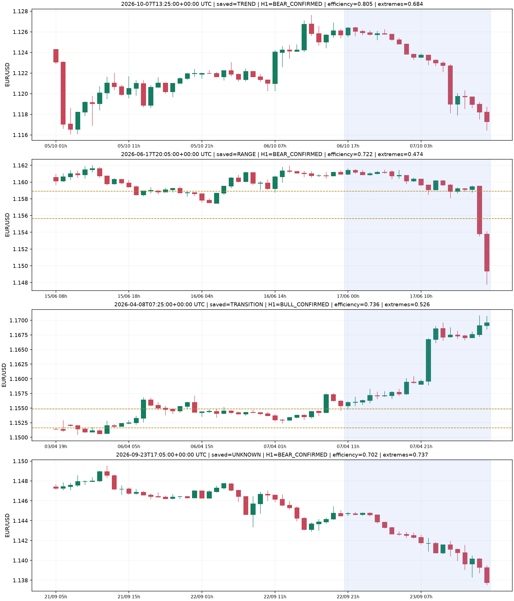

# Auditoria do classificador de regime — 22/10/2026

## Conclusão

Há evidência de um filtro muito restritivo para este catálogo, principalmente
por exigir movimento quase direcional nas últimas 20 barras H1. Não foi
demonstrado que todo bloqueio esteja incorreto. Quatro exemplos visuais mostram
que parte da espera é a confirmação deliberada de rompimentos, e parte decorre
da persistência de estados anteriores. Não houve mudança no agente ativo.

## Método

- Mesmo catálogo de 335 dias, 30 dias de aquecimento, 74.520 candles M5 e
  1.421 candidatos do experimento H1.
- Replay sequencial de H1, com agregação do calendário da corretora e reset
  nas mesmas lacunas inesperadas do fluxo original. Somente candles fechados.
- Reprodução exata das 1.421 classificações salvas antes de interpretar variantes.
- Medição separada de todo o fluxo H1 e dos candidatos catalogados.
- Sensibilidade de parâmetros predefinidos; não houve seleção por lucro.
- Exemplos escolhidos pela maior eficiência, dentro de cada categoria com H1
  confirmado, sem consultar P&L. São casos contrastantes, não amostra aleatória.

## O que bloqueia TREND

O classificador pede, simultaneamente:

1. Eficiência >= 0,65: deslocamento líquido dos fechamentos dividido pelo total
   dos movimentos absolutos entre fechamentos de 20 barras H1.
2. Pelo menos metade dos 19 pares de candles com máximas **e** mínimas avançando
   na direção do movimento. Uma tendência com inside bars pode falhar aqui.
3. Três candidatos consecutivos na mesma direção, em candles H1 distintos.
4. Quando há faixa anterior: aceitação do rompimento e continuidade, antes de
   liberar a nova tendência. A faixa pode persistir até 120 barras H1.

Esses valores têm status `needs_review` no código; não são parâmetros calibrados
e validados para EUR/USD nem fórmulas numéricas atribuídas aos livros.

| Medida no catálogo | Quantidade |
|---|---:|
| Passaram eficiência de 0,65 | 24 |
| Passaram fração de extremos de 0,50 | 346 |
| Geometria simultânea de tendência | 22 |
| Geometria de tendência, mas estado final não TREND | 15 |
| Estado final TREND | 7 |
| Estrutura H1 com direção confirmada | 478 |

Dos 15 candidatos geométricos ainda bloqueados, oito tinham só uma observação
consecutiva e sete tinham duas; sete carregavam uma faixa anterior.

**Correção da explicação anterior:** nenhum dos 359 UNKNOWN catalogados tinha
`missing_data` preenchido. Aqui UNKNOWN significa geometria não classificada ou
confirmação ainda incompleta, não ausência de histórico.

No fluxo completo de H1, além dos candidatos, a regra base produziu 33 estados
TREND em 5.685 observações após o aquecimento, cerca de 0,58%. Portanto, a raridade
não aparece somente por seleção dos candidatos. Esse fluxo também inclui
situações de calendário/dados, distintas dos UNKNOWN geométricos do catálogo.

## Persistência e expiração

Dos 632 candidatos TRANSITION, 602 eram RANGE_TO_TREND. Em 502 registros o evento
de transição estava EXPIRED, embora o regime permanecesse TRANSITION.

O caminho de código explica isso: uma faixa com `EXIT_ACCEPTED` pode continuar
produzindo TRANSITION enquanto espera geometria persistente; o evento de
transição já expirado não volta a passar pela regra de expiração. A faixa só
é descartada pelo prazo próprio ou por uma condição posterior.

Isso merece revisão de semântica e ciclo de vida. Não prova que a solução seja
autorizar entrada: uma expiração pode exigir UNKNOWN e nova avaliação, em vez
de converter automaticamente para TREND.

## Sensibilidade — não são operações nem taxa de acerto

| Variante offline | TREND no catálogo | Elegíveis H1 | Elegíveis H4+H1 |
|---|---:|---:|---:|
| Atual: eficiência 0,65; 3 confirmações | 7 | 2 | 1 |
| Somente eficiência 0,55 | 21 | 16 | 10 |
| Somente eficiência 0,50 | 34 | 21 | 12 |
| Somente 2 confirmações | 14 | 7 | 5 |
| Somente validade da faixa 60 barras | 7 | 2 | 1 |
| Exploratória combinada: eficiência 0,55; extremos 0,45; 2 confirmações | 40 | 27 | 16 |

Menor validade de faixa reduziu TRANSITION de 632 para 440, mas aumentou UNKNOWN
de 359 para 527. Não aumentou TREND nem entradas elegíveis neste catálogo.
Trocar o nome de um bloqueio não resolve o problema de entrada.

## Comparação com os gráficos

A região azul marca a janela de 20 barras; linhas tracejadas são os limites da
faixa congelada que estavam disponíveis naquele instante.

- **07/10/2026 13:25 UTC, TREND:** queda direcional; eficiência 0,805 e três
  confirmações. Exemplo coerente com o critério atual.
- **17/06/2026 20:05 UTC, RANGE:** rompimento vendedor recente; H1 já confirmou
  baixa, mas extremos em 9 de 19 pares (0,474) e faixa anterior mantêm o bloqueio.
  A imagem favorece investigar atraso de classificação, mas duas barras fortes
  também podem representar rompimento que ainda exige aceitação.
- **08/04/2026 07:25 UTC, TRANSITION:** alta com eficiência 0,736, acima da faixa
  anterior e H1 confirmado. Tem duas confirmações, enquanto a regra exige três;
  o evento anterior está EXPIRED. O atraso tem causa explícita no código.
- **23/09/2026 17:05 UTC, UNKNOWN:** queda com eficiência 0,702 e H1 confirmado,
  mas apenas uma observação consecutiva da geometria completa. Uma leitura
  visual de tendência não equivale a satisfazer as três confirmações numéricas.

## Alternativas

1. **Revisar primeiro a coerência dos estados e suas expirações.** Separar falta
   de dados, tendência ainda não confirmada e transição expirada. Reavaliar o
   regime ao expirar, mantendo as proteções de dados e de direção. É a alternativa
   recomendada antes de calibrar limiares; não promete mais operações.
2. **Testar eficiência 0,55 isoladamente**, mantendo três confirmações e os
   bloqueios de direção/risco. Há aumento de candidatos observado; ainda precisa
   de replay financeiro com custos, estabilidade e validação em período novo.
3. **Testar duas confirmações isoladamente.** Menor atraso, maior exposição a
   falsos rompimentos. Não combinar com a alternativa 2 antes de avaliar cada uma.
4. **Redesenhar a distinção tendência/correção.** Direção estrutural H1 e regime
   podem ser duas informações complementares: tendência com correção não precisa
   ser tratada como nova lateralização. É uma mudança conceitual maior, que exige
   exemplos rotulados, critérios de invalidação e teste separado.

Não recomendo retirar o filtro de regime nem liberar todo UNKNOWN para aumentar
o número de operações. Nenhum desses resultados demonstra melhora de acerto.

## Reprodução e registro

Instalar `requirements-research.txt` no ambiente de pesquisa e executar
`python run_regime_audit.py` na raiz do projeto. O script analisa o catálogo
identificado acima, grava `agent_regime_audit` no PostgreSQL e salva JSON/PNG
em `data/reports/`. Nenhum comando é enviado ao MT5.

Registro final `agent_regime_audit`, que reproduziu as 1.421 classificações:
`fd9a849023cc15bd3ed7cfb487190c46c0dbcddc78f2e0cc46568d9b2d35a741`.
O alinhamento temporal relaciona a abertura do candle H1 com o horário de seu
fechamento, usado no snapshot. Registros preliminares continuam preservados.
