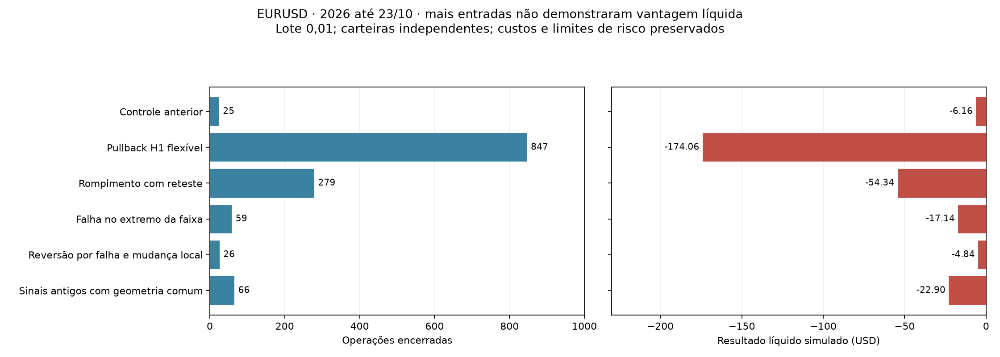

# Estratégias da literatura — Agente Trader - IA

## Mudança de abordagem

Em 23/10/2026, foi autorizada a comparação de estratégias de tendência,
lateralização e reversão, separadamente. A investigação deixa de exigir que
todas usem a mesma combinação de regime TREND, H4/H1 confirmados e pullback M5.

A estratégia em execução não é alterada pelo programa de pesquisa. O código
novo não é importado pelo caminho de decisão ou pelo gateway de ordens.

## O que foi consultado

Foram pesquisados os PDFs locais e lidas **seções selecionadas**, não os livros
inteiros. Brooks é digitalizado e foi conferido visualmente; os demais trechos
permitiram extração textual. As páginas abaixo são posições no PDF, não
necessariamente a numeração impressa.

| Referência | Páginas do PDF | Contribuição para a pesquisa |
|---|---|---|
| Pring, Análise Técnica Explicada | 16–17, 68–71, 89, 132 | Tendências têm horizontes diferentes; suporte/resistência pode mudar de função; uma quebra não garante reversão. |
| Manual do Pullback | 5, 10–11, 13, 16, 20 | Correção em região relevante, retomada e stop coerente; uma consolidação pede regras diferentes do pullback em preço. |
| Wyckoff 2.0 | 32–33, 70, 74 | Contexto, falha nos extremos e resposta posterior; um possível spring/upthrust pode falhar. |
| Brooks, Tendências | 127, 135 | Separar rompimento, falha, setup, entrada e continuidade. |
| Brooks, Lateralidades | 137, 405–406 | Rompimentos precisam de continuidade; faixas têm negociação bilateral e não devem herdar automaticamente as regras de tendência. |
| MARRAIK SMC | 13, 32, 64, 112 | Estrutura interna e contexto superior podem discordar; o movimento maior continua relevante. |
| Reminiscências de um Especulador Financeiro | 79, 157 | Confrontar a tese com o comportamento do preço e a direção do mercado. |
| Douglas, Trading in the Zone | 130, 133–134, 136 | Variáveis e risco definidos antes; avaliação de séries de resultados. O exercício psicológico não demonstra vantagem técnica de uma estratégia. |

O [manifesto de pesquisa](../data/knowledge/literature_families.json) registra
hashes dos exemplares, páginas consultadas, conceitos e famílias relacionadas.
Não publica os PDFs ou cópias dos capítulos. Os conceitos anteriores do catálogo
não foram duplicados nem marcados como aprovados para negociação.

**Os livros não fornecem uma estratégia universalmente “melhor”.** Há diferenças
de horizonte e de abordagem. Por exemplo, SMC dá importância ao contexto macro;
o teste de H4 como evidência, sem veto, é uma alternativa nossa, não uma
recomendação unânime dos autores.

## Famílias implementadas

| Família | Contexto | Gatilho observável | Invalidação / alvo |
|---|---|---|---|
| Pullback em tendência | Viés H1 por EMA20/50 e inclinação da EMA20 | Correção ou toque na média M5, seguido de fechamento de retomada | Extremo recente com buffer; alvo de 3R sobre preço estimado executável |
| Rompimento com reteste | Mesmo viés H1; nível anterior ao rompimento | Rompimento fechado, reteste posterior em até seis candles e retomada | Extremo do reteste; 3R |
| Falha no extremo de faixa | Janela anterior de baixa eficiência direcional e largura compatível com ATR | Varredura do extremo, retorno ao interior e confirmação no candle seguinte | Extremo da falha; alvo próximo do outro lado da faixa |
| Reversão por falha e mudança local | Viés H1 anterior contrário à nova direção | Falha no extremo, microquebra M5 e resposta M15 já fechada | Extremo da falha; 3R |

A reversão é um **padrão candidato**, não uma afirmação de que a tendência maior
já mudou. Lateralização e reversão podem produzir entradas contra o viés H1,
conforme autorizado para estes testes. Elas não recebem estatísticas de operações
de tendência nem reutilizam a aprovação operacional da política antiga.

H4 é registrado como evidência; D1 e o classificador global não vetam todas as
famílias. Não são atribuídas intenções a bancos ou participantes a partir do OHLC.

## Números: hipóteses de engenharia

Os valores EMA20/50 em H1, ATR14, janelas de 20/24 barras, eficiência de 25%,
largura de 2–8 ATR, tolerância de 0,25 ATR, buffer de 0,2 ATR, stop mínimo de
1 ATR, alvo de 3R e duração máxima de duas horas foram fixados **antes** de
calcular resultados. São aproximações testáveis dos conceitos, não uma fórmula
extraída literalmente dos autores. Não foi feita busca de limiares.

O alvo de tendência/reversão parte do preço estimado executável no instante do
sinal: bid mais spread e slippage na compra, bid menos slippage na venda. A
entrada real simulada continua na abertura seguinte; gaps e os custos efetivos
podem vetá-la. A faixa usa um objetivo estrutural conhecido, mesmo quando isso
faz o risco vetar a entrada. Nenhum alvo é deslocado depois para tornar uma
operação rentável.

## O que foi preservado

- EURUSD, candles fechados e fonte congelada do MT5 no PostgreSQL.
- Lote 0,01; capital inicial simulado de US$ 10.000.
- Risco máximo de 0,5% por operação, perda diária de 2%, drawdown de 5%,
  no máximo cinco entradas por dia e uma posição por carteira.
- Spread máximo de 2 pips e retorno/risco líquido mínimo de 2.
- Spread observado, slippage de 0,2 pip e comissão de US$ 35/milhão/lado.
- Rejeição/censura de exposição com dados de mercado inválidos.
- Entradas nas sessões de Londres/Nova York.

As novas carteiras fecham na saída da sessão ou no fechamento semanal conhecido
pelo calendário. Não se pressupõe swap zero para posições mantidas no fim de
semana. O estresse usa os mesmos sinais, stops e alvos, com spread multiplicado
por 1,5 e slippage duplicado para 0,4 pip.

## Comparação e seleção

Usa-se o mesmo arquivo: 60.624 candles de 2026 até 23/10 e aquecimento anterior.
Repetir dados já pesquisados não cria uma validação independente.

1. Reproduzir os controles originais com suas saídas originais (1 e 25 operações).
2. Avaliar também os sinais antigos com a nova geometria comum de alvo e saída.
3. Gerar as quatro famílias a partir de históricos fechados, sem o veto global antigo.
4. Selecionar uma candidata usando **somente janeiro–junho**: pelo menos 50
   operações, líquido positivo e fator de lucro de ao menos 1,1; ordenar pela
   expectativa líquida por operação. Se nenhuma satisfizer, não escolher uma
   “vencedora” apenas por ter o menor prejuízo.
5. Conferir julho–setembro, já visto anteriormente: ao menos 20 operações,
   líquido positivo, fator de lucro de ao menos 1,1 e líquido positivo no estresse.
6. Relatar o ano, cada mês e outubro parcial, sem recalibrar parâmetros.

Esses critérios são filtros de pesquisa, não comprovação estatística nem
autorização para execução. A comparação de famílias muda várias características
do setup; não permite atribuir todo o resultado à retirada de um único filtro.
O controle com geometria comum também muda alvo, horizonte e fechamento de sessão.

O Timestral não participa desta comparação técnica nem tem seus pesos alterados.
Um resultado aqui não valida o conjunto completo do robô adaptativo.

## Reprodução

```powershell
$env:PYTHONPATH='src'
.venv/Scripts/python.exe -m unittest tests.unit.test_literature_strategies -v
.venv/Scripts/python.exe run_literature_experiment.py
```

O programa registra um protocolo antes dos resultados, lê o manifesto local e
confere a integridade da fonte. Registros completos ficam no PostgreSQL e em
`data/reports/`, fora do Git.
## Resultados — versões numéricas testadas

Mesmo EURUSD/2026, lote 0,01 e custos descritos acima. Não são resultados reais da conta.

| Família / controle | Operações | Ganhos / perdas | Acerto | Líquido (USD) | Média por operação (USD) | Fator de lucro |
|---|---:|---:|---:|---:|---:|---:|
| Controle estrito original | 1 | 0 / 1 | 0,0% | -1,18 | -1,177 | 0,000 |
| Controle anterior com correção | 25 | 8 / 17 | 32,0% | -6,16 | -0,246 | 0,662 |
| Pullback H1 flexível | 847 | 264 / 583 | 31,2% | -174,06 | -0,205 | 0,627 |
| Rompimento com reteste | 279 | 74 / 205 | 26,5% | -54,34 | -0,195 | 0,609 |
| Falha no extremo da faixa | 59 | 18 / 41 | 30,5% | -17,14 | -0,290 | 0,337 |
| Reversão por falha e mudança local | 26 | 8 / 18 | 30,8% | -4,84 | -0,186 | 0,728 |
| Sinais antigos com geometria comum | 66 | 14 / 52 | 21,2% | -22,90 | -0,347 | 0,462 |



O controle comum mudou de 25 para 66 operações e terminou com −US$ 22,90.
As novas famílias executaram compras e vendas: pullback 359/488, reteste
111/168, faixa 19/40 e reversão 19/7. As carteiras são independentes; não se
deve somar resultados como se um único agente tivesse executado todas.

## Desenvolvimento e conferência retrospectiva

| Família | Jan–jun: operações / líquido USD | Jul–set: operações / líquido USD | Ano em estresse: operações / líquido USD |
|---|---:|---:|---:|
| Pullback H1 flexível | 511 / -105,05 | 263 / -48,31 | 819 / -243,16 |
| Rompimento com reteste | 189 / -31,28 | 65 / -13,69 | 216 / -68,74 |
| Falha no extremo da faixa | 40 / -12,73 | 17 / -3,78 | 38 / -11,07 |
| Reversão por falha e mudança local | 16 / -1,24 | 7 / -2,27 | 24 / -5,84 |

Nenhuma família passou pelo filtro de desenvolvimento; a seleção registrada
antes de calcular a conferência posterior foi **nenhuma**. Não houve escolha
de uma alternativa com base em um mês favorável. Todas também tiveram líquido
negativo em julho–setembro e no estresse do período completo.

O estresse pode alterar as operações executadas: risco e spread vetam entradas
e a disponibilidade de exposição muda. O menor prejuízo da faixa em estresse
vem acompanhado de menos operações; não demonstra resistência aos custos em
uma amostra pareada fixa. Nenhuma variante passou a ser lucrativa.

## O que a comparação permite concluir

1. **Os filtros antigos realmente reduziam a quantidade de entradas.**
   O pullback flexível executou 847 operações; a referência anterior, 25.
2. **A flexibilização não demonstrou vantagem líquida.** O pullback teve
   US$ 12,94 brutos, mas US$ 187,00 de custos simulados: US$ 94,67 de spread,
   US$ 33,04 de slippage e US$ 59,29 de comissão. O líquido foi −US$ 174,06.
   O bruto médio corresponde a aproximadamente 0,15 pip por operação,
   contra cerca de 2,21 pips de custo médio, para as 1.000 unidades usadas.
3. **Menor prejuízo total não significa melhor estratégia.** A reversão teve
   somente 26 operações e expectativa negativa. Não foi promovida por perder
   menos dólares que a alternativa com 847 operações.
4. **Não há vencedora elegível neste estudo.** O rompimento com reteste teve
   alguns meses positivos, mas o total e a conferência posterior foram negativos.
5. **Isso não invalida os livros.** Reprova a vantagem demonstrada por estas
   definições numéricas, neste ativo, período, execução e custos. Não se testaram
   todas as estratégias possíveis dos autores nem se demonstrou que uma família
   nunca possa funcionar com outra definição ou horizonte.

A investigação passa a separar hipótese, contexto e família, em vez de procurar
um único conjunto de vetos para todo o mercado. O próximo problema de pesquisa
é encontrar movimentos cuja vantagem bruta compense os custos e cujo horizonte
de saída seja coerente com a estrutura. Simplesmente liberar ordens adicionais
ou escolher a versão que perdeu menos não resolve esse problema.

**Nenhuma dessas versões foi ativada no agente em execução.** Os novos registros
não alteram pesos do Timestral, limites de risco ou a política do gateway.

## Auditoria final

- 62 testes direcionados aprovados, incluindo oito novos testes das famílias,
  causalidade dos contextos, reteste posterior, reversão separada, geometria de
  preço executável, fechamento de sessão e custo de estresse.
- Controles originais reproduzidos exatamente, operação por operação.
- Sem posições pendentes, operações censuradas ou contas bloqueadas em todas
  as carteiras normais e de estresse avaliadas.
- Manifesto e protocolo anteriores aos resultados; fonte congelada verificada.
- Protocolo: `7acce71ddf6602254730c28b8cca4446921e526b0b06c3e261ab73300e7ab93d`.
  Registrado em 23/10/2026 às 14:53:56 UTC; conclusão às 14:56:25 UTC.
- Relatório `agent_literature_experiment`:
  `d648f4439e23fb24d2cc880ea9c9507c4bc3fb31860d14d92db1f87e0a54a07d`.
- Sinais e seleção de desenvolvimento têm registros separados no PostgreSQL:
  `agent_literature_signals` e `agent_literature_selection`, pela chave do protocolo.
- Relatório integral: `data/reports/literature-d648f4439e23.json`, fora do Git.
- Verificações de integridade: `agent_literature_verification`, pela chave do
  relatório; hashes dos arquivos de código, dos oito PDFs e do registro no
  PostgreSQL conferidos. O manifesto atual coincide com o registrado no protocolo.

Continuação: [pesquisa dos mesmos conceitos em M15 e H1](PESQUISA_M15_H1.md).
