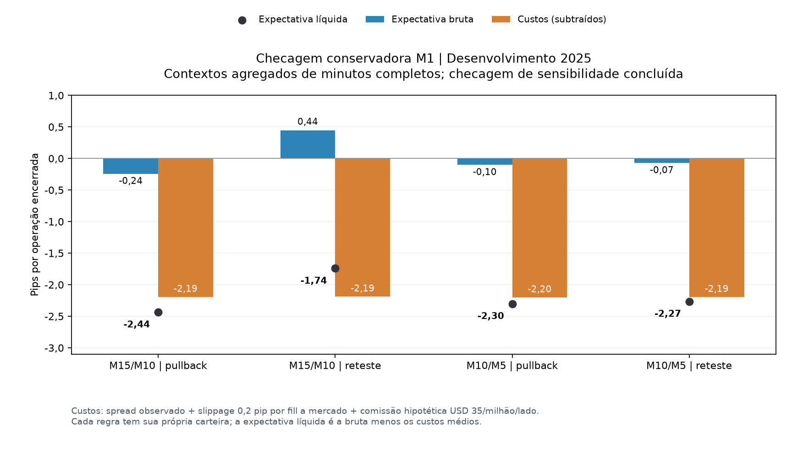
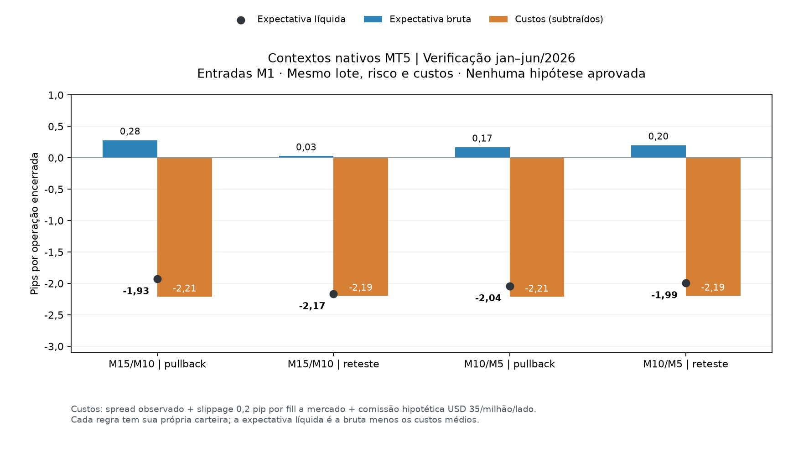

# Entradas M1 com contextos M15/M10 e M10/M5

## Conclusão — 26/10/2026

**Nenhuma das duas hipóteses foi aprovada para ativação, com os gatilhos e
custos testados.** A comparação principal com contextos nativos terminou.
M15/M10 e M10/M5 produziram mais operações nos períodos completos de 2026,
mas todos os seus resultados normais completos foram negativos. Nos cenários
determináveis com comissão zero, spread e slippage ainda produziram perdas.

Os testes usaram dados congelados até **23/10/2026**, lote 0,01 e posições
limitadas a 60 minutos. H4/H1 também permitiu operações curtas; o período de
contexto não transforma, por si só, uma operação em swing trade. A regra de
produção permanece inalterada. Este resultado avalia estas definições concretas,
sem demonstrar que qualquer estratégia M1 seja necessariamente inviável.

## Pergunta e interpretação

Períodos menores podem reagir mais cedo a movimentos intradiários, mas isso
não comprova maior acerto ou lucro após custos. H1/H4 também podem orientar
day trade: o horizonte do contexto e a duração da posição são coisas distintas.
M15 e M10 se sobrepõem e não constituem duas evidências independentes.

Foram consultadas novamente seções de Pring (páginas PDF 68–69) sobre
suporte/resistência e do Manual do Pullback (10 e 13) sobre estrutura preservada
e reteste de região anterior. O manifesto
`data/knowledge/literature_families.json` identifica as referências locais.
EMA, ATR, períodos e limiares deste estudo são definições de engenharia,
não uma receita numérica atribuída aos autores.

## Protocolos registrados antes dos resultados

ID: `4b39756aa50c48dde15f7a1cf8b9798885f2851e14ee999e0d6182060ea1d0fe`.

Esse primeiro protocolo exige agregações completas a partir de M1 e serve como
comparação conservadora. A auditoria posterior dos dados encontrou 232
intervalos com minutos ausentes, dos quais muitos ocorrem na virada diária;
isso pode impedir desproporcionalmente o aquecimento H4/H1 quando todo o
contexto é reiniciado por uma lacuna M1.

**Antes de qualquer seleção financeira**, foi registrado o protocolo primário
com contextos nativos do MT5:
`35520ecaa695eda4130c93568303fbe38e1476cb23ab35c98cf6fbca06275736`.
Ele usa os mesmos quatro perfis, regras e amostra de execução M1, mas busca
M5/M10/M15/H1/H4 diretamente do terminal, com 30 dias adicionais de contexto.
Um minuto sem candle não é preenchido: o OHLC maior é o publicado pela corretora,
que não estabelece uma trajetória intrabar completa. Ausência de um candle
inteiro do contexto invalida seus 60 candles de direção; contexto atrasado e
gatilho M1 com lacunas também bloqueiam sinais.

Uma versão preliminar, `856af733…`, teve apenas a captura executada e foi
substituída antes de gerar sinais/resultados: a versão atual trata a mudança de
alinhamento H4 por horário de verão durante o fim de semana fechado. Lacunas
de negociação continuam inválidas. O mesmo snapshot nativo foi reutilizado e
a alteração está registrada em `agent_m1_native_protocol_amendment`.

Os dois resultados foram preservados. A versão nativa responde à comparação
de períodos vista no MT5; a versão agregada mede a sensibilidade à exigência de
minutos completos. Essa ampliação foi motivada por qualidade dos dados, não
pela escolha de um resultado mais lucrativo.

| Perfil | Direção e confirmação | Gatilho |
|---|---|---|
| Hipótese A | M15 e M10 alinhados | M1 |
| Hipótese B | M10 e M5 alinhados | M1 |
| Controle de contexto | H4 e H1 alinhados | M1 |
| Controle de resolução | H4 e H1 alinhados | M5 |

Cada perfil possui duas carteiras separadas: pullback com retomada e
rompimento com reteste. Compra exige direção positiva em ambos os contextos;
venda exige direção negativa em ambos. Conflito ou contexto indefinido bloqueiam.
Os controles usam a mesma definição EMA20/50 e inclinação de três barras;
não são uma reprodução exata do classificador estrutural em produção.

### Execução e risco

- Todos executam no próximo open **M1 real**, inclusive o controle de gatilho M5.
- Limite comum de 60 minutos por posição, encerramento de sessão e margem de
  cinco minutos antes do fechamento. Nenhuma posição planejada para o dia seguinte.
- Lote 0,01, capital simulado USD 10.000 e limites de risco existentes:
  0,5% por operação, 2% diário, 5% de drawdown, cinco entradas/dia,
  spread máximo de dois pips e relação retorno/risco líquida mínima de dois.
- Stop estrutural, distância mínima de um ATR14 e alvo de três riscos,
  considerando a estimativa de spread e slippage na formulação do alvo.
- Spread histórico M1, slippage de 0,2 pip por execução a mercado e comissão
  hipotética USD 35/milhão por lado. Estresse: spread ×1,5 e slippage 0,4 pip.
- Comissão zero é apenas uma análise pareada de sensibilidade; não escolhe a
  vencedora nem comprova a tarifa futura da conta.
- Se stop e alvo são tocados no mesmo candle, assume-se stop primeiro.
  OHLC M1 não substitui ticks nem reproduz toda a execução da corretora.
- Lacunas inesperadas reiniciam o contexto; exposição sem dados é censurada,
  com resultado total desconhecido. Não há interpolação de preços.

## Dados e separação temporal

Foram capturados 499.999 candles M1 nativos do mesmo MT5, aproximadamente
junho/2025–outubro/2026. O snapshot bruto possui hash e o arquivo normalizado
é congelado no PostgreSQL. O relógio usa o perfil histórico previamente
verificado da corretora, com offset por data; isso não valida uma cotação ao vivo.

1. Desenvolvimento: após sete dias iniciais, até 31/12/2025.
2. Verificação: janeiro–junho/2026.
3. Verificação final histórica: julho/2026 até o encerramento da captura.

Todos os perfis compartilham o mesmo aquecimento e períodos. Contextos mais
longos ainda precisam atingir 60 candles fechados após início ou reinício por
lacuna. A janela final não é evidência prospectiva independente: esses preços
já foram pesquisados em resoluções mais altas.

Escolha somente no desenvolvimento, entre as hipóteses A/B: pelo menos
50 operações encerradas, lucro líquido positivo, fator de lucro ≥1,1,
resultado positivo no estresse e carteira sem exposição não resolvida.
Maior expectativa líquida escolhe a candidata. Se nenhuma passar, não há
vencedora. Antes das verificações, a escolha fica registrada e congelada.
Cada verificação exige pelo menos 20 operações e os mesmos critérios financeiros.
Os resultados de todos os perfis são preservados, inclusive perdas e censuras.

## Verificações já executadas

- 63 testes automatizados passaram, incluindo dez novos testes específicos M1,
  duração real de 60 minutos e invariância dos sinais ao acrescentar dados futuros.
- Cinco testes adicionais verificam os contextos nativos, ausência de dados
  futuros, horário de verão e bloqueios por contexto incompleto/atrasado e por lacunas M1.
- Três testes do auditor detectam alteração de custos, exposição desconhecida,
  contexto futuro e mudança de fonte, além de reconciliar os resultados pareados.
- Dois testes adicionais verificam a comparação pareada por semanas, incluindo
  semanas sem entradas e a impossibilidade de comparar P&L total censurado.
- Amostra nativa: 100 candles por período M5/M10/M15, todos coincidentes em
  OHLC e volume com a agregação dos M1. O spread agregado não foi equiparado
  ao campo spread nativo de outro período, pois a amostragem pode diferir.
- Protocolo, captura, arquivo normalizado, sinais, seleção e relatório são
  registros separados e auditáveis no PostgreSQL.
- Dezesseis reaberturas observadas nos meses das mudanças de horário de verão
  mantiveram o alinhamento do servidor à segunda-feira à meia-noite e à hora
  de domingo 17h em Nova York após conversão. Não houve filtro prévio por
  dia/hora. Uma amostra abriu às 17h00, em vez de 17h03. Essa checagem corrobora
  o perfil histórico escolhido, sem validar individualmente todos os ticks.

## Reprodução

```powershell
.venv/Scripts/python.exe run_m1_context_experiment.py --capture-only
.venv/Scripts/python.exe run_m1_context_experiment.py --resume PROTOCOL_ID
.venv/Scripts/python.exe run_m1_native_context_experiment.py --capture-only
.venv/Scripts/python.exe run_m1_native_context_experiment.py --resume NATIVE_PROTOCOL_ID
```

`--resume` exige os mesmos hashes de implementação e reutiliza os snapshots,
não busca um novo período. Os seis `.npy` brutos ficam em `data/reports/`, fora
do Git: um M1 (`m1-context-raw-4b39756aa50c.npy`) e cinco de contexto nativo
(`m1-native-856af733c546-*.npy`, reutilizados pela versão atual). A replicação
exige preservar esses arquivos e o backup PostgreSQL. O arquivo normalizado
também é verificado por hash antes do replay.

Este estudo não altera o agente em produção, envia ordens nem treina os pesos
do Timestral. Uma eventual aprovação histórica ainda exigiria avaliação futura.

## Resultados

### Checagem conservadora concluída

Relatório PostgreSQL `agent_m1_context_experiment`:
`cad0945c77a3f307ca46e7757096d73f3312de7f514c1a3c99a663973402e9f8`.

Cada célula mostra **operações encerradas / resultado líquido em USD**, no
cenário normal, lote 0,01. São carteiras separadas por perfil e período.

| Contexto e gatilho M1 | Desenvolvimento 2025 | Jan–jun/2026 | Jul–out/2026 |
|---|---:|---:|---:|
| M15/M10 — pullback | 641 / −156,09 | 639 / −123,82 | 395 / −103,90 |
| M15/M10 — rompimento/reteste | 327 / −56,96 | 378 / −76,31 | 168 / −34,85 |
| M10/M5 — pullback | 655 / −150,77 | 640 / −131,76 | 415 / −87,73 |
| M10/M5 — rompimento/reteste | 465 / −105,33 | 442 / −87,86 | 220 / −45,68 |

Nenhuma candidata passou no desenvolvimento; a seleção foi congelada como
`null` antes das verificações. As quatro regras também tiveram resultado normal
negativo nos dois períodos seguintes. A sensibilidade com comissão zero manteve
perdas nessas quatro regras nos três períodos; spread e slippage continuam cobrados.

A contagem de entradas respeita o limite existente de cinco por dia. No
desenvolvimento, o pullback M15/M10 teve 4.398 propostas bloqueadas por esse
limite; M10/M5 teve 7.477. Portanto, aumentar sinais brutos não se traduz
proporcionalmente em mais operações executadas sob a política de risco testada.

O custo médio foi aproximadamente **2,19–2,21 pips por operação**. Por exemplo,
M15/M10 com rompimento/reteste teve expectativa bruta de 0,44 pip no
desenvolvimento e custo médio de 2,19 pips. A mediana das durações ficou entre
7 e 18 minutos, conforme perfil e período: são efetivamente entradas curtas.



Algumas carteiras sob estresse tiveram exposição censurada por lacuna e seu
resultado total é indeterminado (`null`), sem substituição por zero nem soma
de parcelas conhecidas como resultado completo. A frequência comparativa H4/H1
foi avaliada na versão nativa; o aquecimento insuficiente desse controle limita
a comparação na versão conservadora.

A auditoria verificou 96 arquivos declarados de implementação, 63.069 sinais,
96 carteiras e 20.559 resultados encerrados **pareados**, incluindo cenários de
custos do mesmo sinal. Essa contagem não representa 20.559 experiências
independentes. Custos, saldo, duração de até 60 minutos, vínculo ao sinal,
direção e ausência de contexto futuro foram conferidos. A dependência de
seleção/estatística também coincide com o hash do estudo anterior selado.

Uma análise descritiva adicional usa 5.000 reamostragens de semanas de calendário
pareadas, incluindo semanas sem operações e semanas parciais nas bordas. A
diferença é sempre o resultado da primeira carteira menos o da segunda, com
lote e capital fixos. Não altera seleção nem aprovação, não corrige múltiplas
comparações e não demonstra desempenho futuro.

No rompimento/reteste, M15/M10 perdeu USD 48,36 menos que M10/M5 no
desenvolvimento, mas a vantagem descritiva caiu para USD 11,55 na verificação
e USD 10,83 no período final. Os intervalos de 95% das diferenças foram
respectivamente [26,55; 71,12], [−3,25; 27,74] e [−1,03; 22,23]. Portanto,
a diferença entre duas regras perdedoras não constitui validação; os dois
últimos intervalos incluem zero. Diferenças contra o controle H4/H1 conservador
incluem o efeito da indisponibilidade de contexto e exigem essa ressalva.

### Comparação principal com contextos nativos

**Concluída e auditada.** Relatório `agent_m1_native_experiment`:
`7cacbfdcf469f5492e81e4f771cf6fae2ff03d761cf7797589640fdf990711ab`.

Cada célula mostra **operações encerradas / resultado líquido em USD**, no
cenário normal. São carteiras separadas, com o mesmo lote 0,01 e capital inicial.
Não somar as estratégias como se constituíssem uma carteira única.

| Contexto e gatilho | Desenvolvimento 2025 | Jan–jun/2026 | Jul–23/out/2026 |
|---|---:|---:|---:|
| M15/M10, M1 — pullback | 386 + 1 censurada / indeterminado | 640 / −123,38 | 410 / −93,13 |
| M15/M10, M1 — rompimento/reteste | 436 / −94,88 | 415 / −89,87 | 210 / −44,68 |
| M10/M5, M1 — pullback | 389 + 1 censurada / indeterminado | 640 / −130,59 | 415 / −85,94 |
| M10/M5, M1 — rompimento/reteste | 475 / −104,15 | 442 / −88,07 | 232 / −48,41 |
| H4/H1, M1 — pullback | 428 / −99,87 | 403 / −86,95 | 292 / −78,65 |
| H4/H1, M1 — rompimento/reteste | 240 / −46,07 | 224 / −46,51 | 110 / −23,16 |
| H4/H1, M5 — pullback | 131 + 1 censurada / indeterminado | 322 / −56,71 | 251 / −60,80 |
| H4/H1, M5 — rompimento/reteste | 119 / −9,33 | 120 / −24,95 | 67 / −15,89 |

Nenhuma hipótese curta cumpriu os critérios de desenvolvimento: os pullbacks
tinham exposição censurada e os rompimentos tinham resultado líquido negativo.
A escolha foi congelada como `null` antes das verificações. Nenhuma substituição
posterior de vencedora ou ativação foi realizada. Os controles H4/H1 também
não apresentaram uma estratégia lucrativa validada.

As três censuras normais de desenvolvimento foram reproduzidas exatamente em
uma auditoria adicional (`agent_m1_native_censor_audit`, chave do relatório).
Os dois pullbacks curtos tinham posição aberta durante a ausência dos M1 de
16/10/2025, 09h21–09h24 UTC. O controle H4/H1 com gatilho M5 estava exposto
durante a lacuna de 05/09/2025, 16h24–16h34 UTC. As carteiras foram bloqueadas
e seus resultados totais mantidos indeterminados; nenhuma saída favorável foi
inventada para completar o histórico.

#### Frequência, acerto e custos

- Em janeiro–junho, os pullbacks M1 curtos tiveram **640 entradas**, contra
  403 com contexto H4/H1 e gatilho M1, e 322 com H4/H1 e gatilho M5. O limite
  de cinco operações/dia continuou valendo em todas as carteiras.
- Nesse mesmo período, o acerto do pullback foi 25,31% para M15/M10 e 23,75%
  para M10/M5. O controle H4/H1 teve 24,81% com M1 e 35,71% com M5.
  Esses percentuais são resultados observados e não significam vantagem futura.
- Em julho–outubro, os pullbacks curtos fizeram 410 e 415 operações, contra
  292 e 251 nos dois controles. Todos tiveram prejuízo líquido.
- Nos períodos completos de 2026, as quatro hipóteses curtas tiveram custo
  médio de **2,18–2,21 pips por operação**, enquanto a expectativa bruta ficou
  entre −0,09 e +0,28 pip. As medianas de duração ficaram entre 8 e 17,5 minutos.
  O movimento capturado não pagou os custos modelados.
- Todos os resultados normais completos e todos os resultados completos com
  comissão zero foram negativos, incluindo os controles. Spread e slippage
  permanecem presentes na sensibilidade de comissão zero.



#### Robustez e comparação entre as hipóteses

Todas as diferenças semanais determináveis de P&L entre M15/M10 e M10/M5
tiveram intervalos descritivos de 95% que incluíram zero. Por exemplo, no
rompimento/reteste, a diferença foi +USD 9,27 no desenvolvimento, −USD 1,80
na verificação e +USD 3,72 no período final; os intervalos respectivos foram
[−5,57; 23,11], [−14,16; 12,10] e [−2,93; 9,48]. Não apareceu superioridade
financeira consistente de uma hipótese curta sobre a outra.

As carteiras sob estresse também não qualificaram as hipóteses. Algumas foram
censuradas por lacunas de cotação e permanecem indeterminadas. Uma célula
isolada positiva do controle H4/H1 com M1 e rompimento, no estresse final
(USD 1,95), coexistiu com prejuízo normal (−USD 23,16) e não passou pela seleção.
O estresse altera quais entradas são aceitas pelos limites de risco; portanto,
não representa simplesmente subtrair mais custos dos mesmos negócios.

A auditoria principal conferiu **97 arquivos declarados de implementação,
98.996 sinais, 96 carteiras e 30.656 resultados financeiros encerrados
pareados**. Esses resultados de cenários não são experiências independentes.
A dependência de seleção/estatística foi verificada adicionalmente. O arquivo
de execução M1, os contextos nativos e os relatórios permanecem congelados
no PostgreSQL e nos snapshots com hash.

**Decisão:** encerrar este experimento sem promover as duas configurações.
Mais entradas não produziu vantagem após custos. A próxima pesquisa exigirá
uma hipótese nova e explicitamente registrada; os parâmetros deste teste
não serão ajustados retroativamente para procurar uma vitória.

### Auditoria reproduzível

```powershell
.venv/Scripts/python.exe verify_m1_context_results.py cad0945c77a3f307ca46e7757096d73f3312de7f514c1a3c99a663973402e9f8
.venv/Scripts/python.exe verify_m1_context_results.py 7cacbfdcf469f5492e81e4f771cf6fae2ff03d761cf7797589640fdf990711ab --native
```

O auditor lê registros selados e preserva seu resultado no PostgreSQL como
`agent_m1_context_verification`. Os relatórios completos ficam em `data/reports/`.
