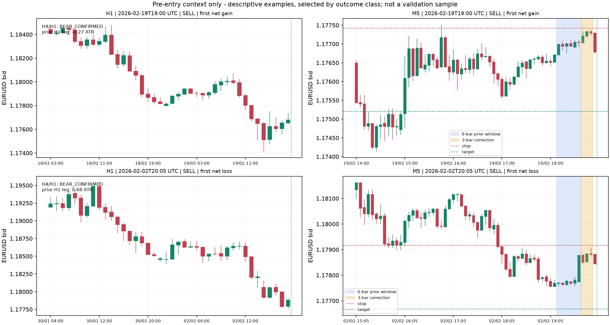

# Contexto anterior à entrada — Agente Trader - IA

Investigação concluída em 23/10/2026, sem ordens e sem mudança na produção.

## O que foi investigado

O setup original observa correção no candle anterior ou na EMA e um fechamento
M5 de retomada, além das condições de contexto e risco. Isso não demonstra, por
si só, que houve uma perna de impulso seguida de correção proporcional.

Esta investigação reutiliza os 107 sinais da **hipótese experimental com
correção**, não as operações da política estrita atualmente ativa. Foram
reconstruídos os contextos M5/H1 a partir dos 74.520 candles congelados, com
verificação de hashes e concordância dos fechamentos H4/H1 com as observações
originais. O período conhecido abrange 335 dias de análise até 20/10/2026.

Foram separadas três etapas: filtros fixados antes do cálculo; auditoria
descritiva por pivôs e gráficos; teste complementar motivado pela auditoria.
Nenhuma delas é uma nova validação independente fora da amostra.

## 1. Três filtros independentes de contexto

| Alternativa | Definição fixada antes dos resultados |
|---|---|
| Impulso H1 anterior | Deslocamento a favor da entrada nas três H1 fechadas antes do início da correção M5 >=1 ATR14 anterior àquela perna |
| Impulso/correção M5 | Seis M5 anteriores à correção avançam >=1 ATR14 anterior à perna; os três candles de correção devolvem >0 e <=50% da excursão |
| Espaço estrutural H1 | O próximo swing H1 confirmado no caminho do alvo está no alvo ou além; mapa ausente não conta como espaço livre |

Os filtros não foram combinados, e os limiares não foram calibrados depois dos
resultados. Stop, alvo 2,5R, lote 0,01, direção H4/H1, 60 minutos de duração,
custos, retorno/risco mínimo líquido 2 e limites diários permaneceram iguais.
Todos os braços usam a exclusão comum de duas horas no fim de cada período,
compatível com o estudo anterior; ela não mudou o controle nesta fonte.

### Resultado do período completo

| Contexto | Sinais | Operações | Ganhos / perdas | Acerto | Líquido USD | Média/operação USD |
|---|---:|---:|---:|---:|---:|---:|
| Referência experimental | 107 | 25 | 8 / 17 | 32% | -6,16 | -0,25 |
| Impulso H1 anterior | 35 | 12 | 3 / 9 | 25% | -6,87 | -0,57 |
| Impulso/correção M5 em janela fixa | 9 | 3 | 1 / 2 | 33,3% | -0,44 | -0,15 |
| Espaço H1 até o alvo | 21 | 6 | 1 / 5 | 16,7% | -3,01 | -0,50 |

Nenhum filtro ficou lucrativo. A redução da perda total no braço M5 veio com
apenas três operações; não demonstra uma estratégia utilizável.

### Resultado por período — líquido USD

| Contexto | Desenvolvimento | Validação | Final já conhecida |
|---|---:|---:|---:|
| Referência | +1,31 | -3,54 | -3,93 |
| Impulso H1 | -2,62 | -1,84 | -2,40 |
| Janela M5 | +0,29 (2 operações) | 0 (sem operações) | -0,73 (1 operação) |
| Espaço H1 | -2,13 | -0,87 | 0 (sem operações) |

### O que os contextos das 25 operações mostram

- Dez tinham deslocamento M5 líquido contrário à entrada na janela de impulso
  escolhida; cinco tinham deslocamento H1 anterior contrário à entrada.
- Só duas das 25 atendiam simultaneamente ao impulso M5 e à correção de até
  50% nessa definição. A carteira filtrada teve três operações porque excluir
  sinais também muda quais entradas posteriores encontram a carteira livre.
- Em 17 casos, a correção ultrapassava a excursão inteira da pequena perna
  escolhida. Isso pode indicar recorte inadequado ou outro tipo de formação;
  não prova que todo o movimento maior havia sido revertido.
- A idade mediana de confirmação do pivô H1 protegido foi 1,25 hora nos oito
  ganhos e 5,58 horas nas 17 perdas. É associação descritiva de amostra pequena,
  não evidência para escolher um novo limite de idade.
- Dez operações não tinham um swing H1 conhecido adiante no caminho do alvo.
  Os demais níveis são um proxy de pivôs, não um mapa validado de força de
  suporte/resistência; pivôs antigos podem ter perdido relevância.

Todas as 25 operações da referência são vendas. As compras sinalizadas não
passaram pelo risco líquido, conforme a investigação anterior. Esses dados não
permitem avaliar compras executadas.

## 2. Auditoria estrutural: janela não é a mesma coisa que perna

Uma janela fixa de seis candles pode cair dentro da própria correção de uma
perna maior. Portanto, falhar no filtro dessa janela não significa que não
existiu impulso no mercado. **A janela de seis M5 é uma definição deste teste,
não uma descrição do algoritmo de produção.**

Foi feita uma auditoria descritiva das 25 entradas com pivôs confirmados:

- O fim da perna é o último extremo no sentido da operação cujo candle fechou
  antes do início dos três candles de correção.
- A origem é o pivô oposto anterior; ambos precisam estar confirmados até a
  decisão. Confirmá-los depois da entrada seria uso indevido de informação futura.
- A amplitude usa os extremos da perna e ATR14 anterior à origem.

Nove das 25 entradas tinham perna M5 forte e correção de até 50% por esse
critério, contra duas na janela fixa. A diferença mostra uma limitação de
representação do movimento, não uma melhora financeira demonstrada.

### Exemplos antes da entrada



A figura contém o primeiro ganho líquido e a primeira perda líquida da
referência, selecionados cronologicamente dentro de cada classe. É ilustração
retrospectiva, não amostra representativa nem validação humana. Não há candles
posteriores ao gatilho. Azul mostra a janela M5 de seis candles; amarelo, os
três de correção. As linhas indicam o stop e alvo originais.

No ganho de 19/02, H1 mostra uma queda maior, mas as janelas recentes H1/M5 já
estavam na recuperação. Na perda de 02/02, o recorte M5 fixo também não captura
toda a perna descendente anterior. Não se pode atribuir a diferença dos
resultados a uma única dessas observações visuais.

Reprodução da figura e auditoria: `python run_context_review.py`, com as
dependências opcionais de `requirements-research.txt`.

## 3. Teste complementar por pivôs conhecidos

Depois da auditoria, foi registrado **outro protocolo**, antes de calcular a
carteira desta alternativa. Ele muda a representação da perna — extremos de
swings confirmados e duração estrutural, em vez de abertura/fechamento de seis
M5 — mantendo amplitude >=1 ATR, correção >0 e <=50%, os mesmos sinais e todos
os parâmetros de execução. Não combina os três filtros da primeira etapa.

| Definição M5 | Sinais | Operações | Ganhos / perdas | Acerto | Líquido USD |
|---|---:|---:|---:|---:|---:|
| Janela fixa | 9 | 3 | 1 / 2 | 33,3% | -0,44 |
| Perna por pivôs confirmados | 26 | 9 | 2 / 7 | 22,2% | -2,86 |

O braço por pivôs ganhou +1,93 USD no desenvolvimento, perdeu -2,51 USD na
validação e -2,28 USD na janela final. O resultado médio foi -0,32 USD por
operação. A representação estrutural encontrou mais contextos, mas não
produziu vantagem financeira neste conjunto.

Essa etapa nasceu da inspeção de preços já conhecidos. Não deve ser tratada
como confirmação independente da hipótese nem como modelo pronto para promoção.

## Conclusão

Há uma limitação real no uso de janelas fixas para representar pernas de
mercado, e o gatilho simples não garante uma correção proporcional. Entretanto,
nem exigir os contextos testados nem trocar a janela por pivôs tornou essa
hipótese lucrativa. **Não ativar nenhuma dessas alternativas no agente demo.**

Os resultados não sustentam apenas adicionar mais filtros ou reduzir o
retorno/risco mínimo exigido. Qualquer novo setup precisa definir de forma coerente contexto,
perna, entrada, invalidação e horizonte, e ser validado em dados novos. A
investigação não prova que nenhum método de pullback funcione; limita-se às
definições e à fonte descritas aqui.

## Reprodução e registros

Execute na ordem, usando PostgreSQL e o histórico congelado existentes:

```powershell
.venv/Scripts/python.exe run_context_experiment.py
.venv/Scripts/python.exe run_context_review.py
.venv/Scripts/python.exe run_pivot_context_experiment.py
```

- Protocolo principal: `4725ecc5731f37cb06765ad37edf646a3981466e20502aa2fb8b2608b36a1f51`,
  registrado em 23/10/2026 às 13:22:32 UTC (10:22:32 de Brasília).
- Relatório principal `agent_context_experiment`:
  `fb8d9cd051243e66b9ad356f245ff50dd61627763b128d5ae3c6237732934af2`.
- Auditoria final `agent_context_review`:
  `dcd4584c1836ea545680e3918d673d60e69f9ba1a3907e2f0377acc7a82c0c68`.
- Protocolo complementar: `6452b4e95a82eb4dd10f06f153cf694805572b2290fd2d59df858bf671b9c395`,
  registrado em 23/10/2026 às 13:33:42 UTC (10:33:42 de Brasília).
- Relatório complementar `agent_pivot_context_experiment`:
  `c9ab36ad2107e261066aacdcb798583e854e66d961d6d1dba2d4d61eb3b71d80`.
- JSONs completos em `data/reports/`, fora do Git. A figura é versionada.
- Controle original e controle de janela fixa reproduzidos exatamente; nenhum
  resultado censurado ou posição pendente nos braços avaliados.
- O período reservado do estudo prospectivo de 22–29/10 permanece fora desta fonte.
- Nenhum modelo Timestral, limite de risco ou estado da sessão foi modificado.
- Validação: 23 testes direcionados passaram; hashes dos registros no PostgreSQL
  e dos arquivos de implementação conferidos com os relatórios registrados.

Continuação: [recaptura do MT5 e testes no calendário de 2026](VALIDACAO_HISTORICA_2026.md).
