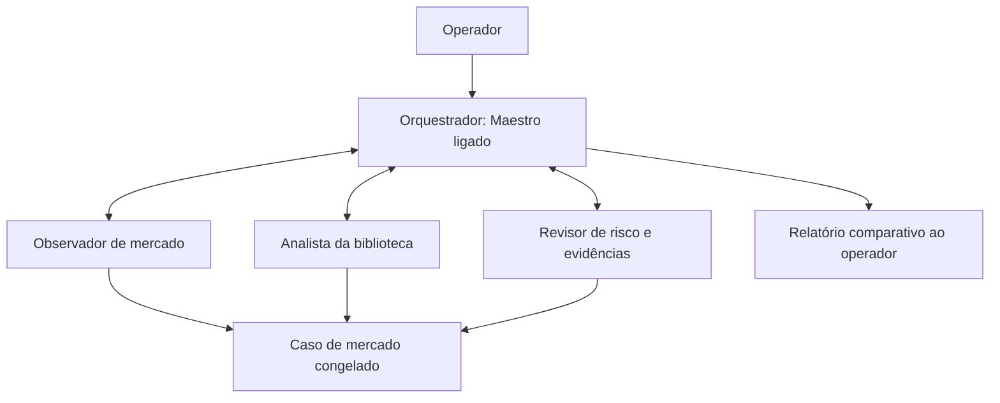

# Maestri: preparação e observação do agente trader

## Corrigir a inicialização

A mensagem `exec: codex: not found` significa que o shell do terminal não
localizou o executável. A responsabilidade do agente não causa esse erro.
Nesta VM, a extensão do VS Code fornecia seu próprio Codex, mas esse caminho
não estava disponível no terminal WSL mostrado no Maestri.

Instale o CLI oficial no Ubuntu, como usuário Rafael:

```bash
curl -fsSL https://chatgpt.com/codex/install.sh | sh
```

O procedimento oficial está em https://learn.chatgpt.com/docs/codex/cli.
Para esta instalação, use no campo **Comando** do terminal:

```text
/home/rafael/.local/bin/codex --no-daemon
```

Configure **Executa em: WSL**, **Distribuição: Ubuntu**, usuário **rafael**,
**Diretório de Trabalho: /home/rafael/agente_trader**. O caminho absoluto evita
que o terminal dependa do PATH herdado do Windows ou do VS Code. Salve e reinicie
o terminal. Se o Codex solicitar autenticação, escolha entrar com ChatGPT;
não coloque tokens no comando, na responsabilidade ou nos arquivos do projeto.

O Maestri pode iniciar o terminal dentro de `.maestri/roles/<id>/` para aplicar a
responsabilidade. Isso é esperado: o agente deve ler a responsabilidade e então
trabalhar em `/home/rafael/agente_trader`, lendo também o AGENTS.md da raiz.
Não use `--cd` para contornar a pasta da responsabilidade antes de ela ser lida.
Não edite os arquivos gerados em `.maestri/roles` para alterar a configuração:
faça isso na tela de responsabilidades do Maestri.

## Estrutura inicial

Comece com quatro terminais de IA, todos no mesmo Ubuntu:



| Terminal | Maestro | Responsabilidade |
|---|---|---|
| Orquestrador existente | Ligado | Reutilizar MAESTRI_ORCHESTRATOR e acrescentar o complemento abaixo |
| Observador | Desligado | `docs/maestri_roles/observador.md` |
| Biblioteca | Desligado | `docs/maestri_roles/biblioteca.md` |
| Revisor | Desligado | `docs/maestri_roles/revisor.md` |

O complemento do orquestrador está em `docs/maestri_roles/orquestrador.md`.
No Maestri, crie as três responsabilidades restantes usando os textos desses
arquivos e atribua cada uma ao terminal correspondente, como fez com o principal.
Ligue o Orquestrador aos três terminais pelas conexões do canvas. Os especialistas
não precisam estar conectados entre si neste primeiro teste. Monitorar Atividade
pode permanecer ligado, como na configuração apresentada.

Antes de criar novos terminais, o orquestrador deve executar `maestri list` para
reutilizar os existentes; consulte também `maestri role list` e
`maestri preset list`. Essa CLI deve ser executada **dentro de uma sessão iniciada
pelo Maestri**, onde o contexto e as conexões do canvas estão disponíveis.
Uma sessão do IDE não ganha controle do canvas apenas por ter o repositório aberto.

Depois de conectados, a delegação usa os nomes reais retornados por `maestri list`:

```text
maestri ask "Observador" "Inspecione o estado e localize o último book_market_case. Informe case_id, as_of, tendência H1, qualidade e lacunas. Somente leitura."
```

O exemplo pressupõe que esse seja o nome conectado. Não envie tarefas a nomes
inventados nem crie outro orquestrador quando o existente puder ser reutilizado.

## Relação com os agentes já implementados

Os oito especialistas Python compartilham o modelo local e usam pacotes privados
em `data/references_cache/book-skills/`. Eles não viram terminais Maestri
automaticamente. O terminal Biblioteca consulta essas skills e acompanha os
pareceres do worker. Um Codex aberto no Maestri é outra sessão de modelo; não é
a instância Qwen que já está executando no serviço.

Os serviços systemd continuam responsáveis pelos processos persistentes. O Maestri
coordena tarefas, inspeciona resultados e apresenta a comparação. Abrir um terminal
não deve iniciar uma segunda cópia do agente trader ou do worker de pesquisa.

Adicione terminais especializados por livro apenas depois de validar o fluxo com
quatro terminais. Por exemplo, crie um papel Wyckoff que leia
`knowledge_skills/wyckoff/SKILL.md` e seu pacote privado, limitado ao mesmo caso.
Não é necessário abrir oito sessões Codex para visualizar os oito perfis Python.

## Primeiro experimento

Cole no Orquestrador:

> Leia o AGENTS.md da raiz e docs/MAESTRI_ORQUESTRACAO.md. Execute maestri list
> e reutilize os terminais conectados. Quero observar o trader em pesquisa,
> mantendo as entradas pausadas. Peça ao Observador um único book_market_case
> existente e distribua exatamente esse case_id e as_of à Biblioteca e ao Revisor.
> A Biblioteca deve comparar apenas técnicas com fichas disponíveis; o Revisor
> deve procurar contradições, informação futura, lacunas e problemas de risco.
> Entregue uma tabela com fonte/página, evidência observada, interpretação,
> condição ausente, invalidação e motivo para esperar ou estudar uma entrada
> a favor da tendência H1. Mostre explicitamente pareceres incompletos e falhas.
> Não modifique código, configuração, serviços ou a sessão de negociação neste
> experimento. Não reative ordens. Não registre nova rotina recorrente.

A primeira rodada é de inspeção: não precisa gerar novas inferências demoradas.
Use relatórios já existentes; se faltar o mesmo caso em alguma fonte, registre
que a comparação não pôde ser concluída. Uma inferência nova deve ser uma tarefa
separada, com orçamento, versão e caso congelado, sem iniciar outro worker.

Comandos úteis para terminais de shell (sem responsabilidade de IA):

```bash
systemctl --user status agente-trader-agent.service agente-trader-book-specialists.service --no-pager
journalctl --user -u agente-trader-book-specialists.service -n 20 --no-pager -o cat
cat data/reports/book-specialists/latest.json
```

Esses comandos não retomam negociação. O painel da aplicação continua separado
do canvas do Maestri. Os detalhes do fluxo de skills estão em
[AGENTES_ESPECIALISTAS_LIVROS.md](AGENTES_ESPECIALISTAS_LIVROS.md).

## O que esta preparação não demonstra

Uma responsabilidade descreve o trabalho; não instala o Codex, não conecta
terminais por si só e não valida uma estratégia. Uma primeira rodada bem-sucedida
mostra colaboração e rastreabilidade; qualidade semântica e execução operacional
continuam exigindo avaliação própria. As skills permanecem parciais e as entradas
continuam pausadas até a validação da estratégia.
