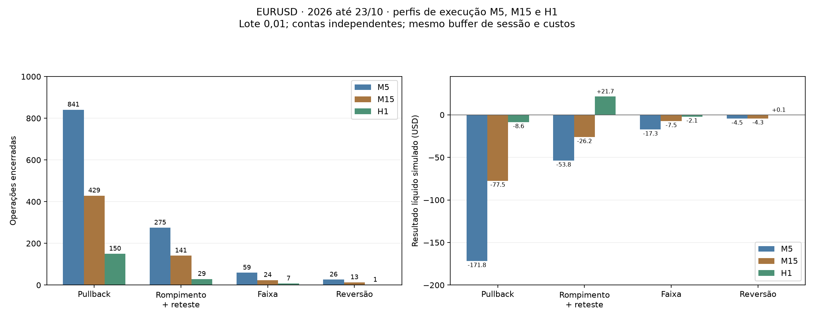

# Pesquisa em M15 e H1 — Agente Trader - IA

Continuação: a [validação ampliada em 2021–2025](VALIDACAO_H1_AMPLIADA.md)
não aprovou a candidata H1. O resultado positivo abaixo motivou a pesquisa,
mas não se manteve consistentemente nos anos adicionais.

## Hipótese

O estudo anterior em M5 encontrou movimentos brutos pequenos diante dos custos.
Esta investigação testa se estruturas e horizontes maiores melhoram o resultado
líquido, mantendo os custos e limites de risco. Não promete lucratividade nem
altera a estratégia em execução.

## Perfis fixados antes dos resultados

| Execução da estratégia | Contexto direcional | Resposta adicional | Macro registrado | Prazo máximo nominal |
|---|---|---|---|---|
| M5, controle | H1 | M15 | H4 | 2 horas |
| M15 | H1 | H1 | H4 | 6 horas |
| H1 | H4 | H4 | D1 | 24 horas |

As mesmas quatro famílias são comparadas em cada perfil: pullback, rompimento
com reteste, falha nos extremos da faixa e reversão por falha/mudança local.
Lateralizações e reversões permanecem pesquisas separadas, inclusive quando
contrariam o contexto anterior, conforme autorizado.

O contexto e a resposta adicional coincidem no M15 e no H1. São informações
correlacionadas; não são duas confirmações estatisticamente independentes.
No perfil H1, “a favor da tendência” significa a favor do contexto **H4**.
Isso não equivale à regra antiga de alinhamento obrigatório entre H4 e H1.

## Como o preço é usado

1. M15 e H1 são agregados a partir dos candles M5 originais do MT5 no PostgreSQL.
2. Somente buckets completos são aceitos; candles parciais não geram entrada.
3. O sinal só pode nascer no fechamento nominal do candle de execução. Um
   candle antigo emitido tardiamente após um fechamento de mercado não é
   tratado como sinal novo.
4. ATR, correção, extremos, níveis e buffers usam o timeframe de execução.
5. A ordem simulada entra na abertura do **M5 seguinte**, no preço executável.
6. Stop, alvo e saídas são verificados nos M5 originais. Se stop e alvo forem
   tocados no mesmo M5, o simulador usa a ordem conservadora de stop primeiro.

Assim, não se presume que todo o OHLC de uma hora estivesse disponível no início
daquela hora, nem se inventa uma trajetória favorável dentro do candle H1.

## Parâmetros e limites

- Mesmos conceitos e números por barra da pesquisa da literatura: EMA20/50
  no contexto, ATR14, janelas de 20/24 candles, stop mínimo de 1 ATR e buffers
  anteriores. São hipóteses de engenharia, não fórmulas literais dos livros.
- Alvo de 3R sobre o preço estimado executável para tendência e reversão;
  na faixa, objetivo estrutural próximo do extremo oposto.
- Prazo máximo de **24 candles de execução**. A execução financeira continua
  em M5: 24, 72 ou 288 candles M5, conforme o perfil.
- Fechamento obrigatório ao fim da sessão ou fechamento semanal conhecido.
  No H1, o prazo nominal de 24 horas normalmente é interrompido por essa regra.
  Portanto, este estudo não avalia swing trades mantidos durante a noite.
- Lote 0,01, capital inicial de US$ 10.000, uma exposição por carteira.
- Risco máximo de 0,5% por operação, perda diária de 2%, drawdown de 5%,
  cinco entradas por dia, spread máximo de 2 pips e retorno/risco líquido mínimo 2.
- Custos anteriores: spread histórico, 0,2 pip de slippage e comissão assumida
  de US$ 35 por milhão por lado. A comissão é premissa do simulador, não
  comprovação da tarifa da conta.
- Estresse: sinais, stops e alvos congelados, spread multiplicado por 1,5 e
  slippage de 0,4 pip. Vetos de risco podem mudar o conjunto de operações.

Fechamentos semanais conhecidos não são tratados como candles perdidos nos
padrões M15/H1. Gaps M5 inesperados continuam invalidando e reiniciando o
contexto. O caminho M5 original é preservado para a verificação de regressão.

## Comparabilidade e seleção

O arquivo contém 60.624 candles M5 de 2026 até 23/10, mais aquecimento anterior.
É a mesma fonte dos estudos anteriores: **não é uma validação independente**.

Todas as 12 carteiras da matriz usam um descarte comum de novas entradas nas
últimas **24 horas** de cada janela, cobrindo o horizonte nominal mais longo.
Os sinais descartados não são operações perdidas. O controle M5 original é
reproduzido separadamente com seu descarte original de duas horas; seus números
podem diferir do M5 da matriz, que segue o descarte comum de 24 horas.

- Janeiro–junho: selecionar somente entre M15/H1, exigindo ao menos 50
  operações, líquido positivo e fator de lucro de ao menos 1,1; ordenar por
  expectativa líquida por operação. Sem elegíveis, não selecionar uma perdedora.
- Julho–setembro: conferência retrospectiva sem recalibrar, com ao menos 20
  operações, líquido positivo, fator de lucro de ao menos 1,1 e líquido positivo
  sob estresse. Exigir ausência de censura, bloqueio ou posição pendente.
- Relatar também o ano, os meses e outubro parcial.

Alterar o timeframe também altera duração física das janelas, volatilidade,
stops e, no H1, o contexto superior. A matriz não identifica o efeito causal
isolado de cada uma dessas mudanças. Não foi feita busca de limiares para
encontrar uma combinação positiva.

O lote constante não iguala o risco em dólares de todas as entradas: stops
maiores podem arriscar mais, sempre dentro do teto original. O total financeiro
deve ser lido junto com quantidade, expectativa, fator de lucro e drawdown.

## Reprodução

```powershell
$env:PYTHONPATH='src'
.venv/Scripts/python.exe -m unittest tests.unit.test_timeframe_experiment tests.unit.test_literature_strategies -v
.venv/Scripts/python.exe run_timeframe_experiment.py
```

O protocolo é registrado antes dos resultados. A fonte e os sinais ficam
congelados no PostgreSQL; JSONs completos em `data/reports/`, fora do Git.
As saídas padrão das funções antigas preservam o comportamento M5 para
comparação exata com a versão anterior.

## Primeira execução e auditoria de dados

O primeiro protocolo foi registrado antes dos resultados:
`d05129577f4a4479a4be6da2cd73398dbac3685a5ab22fb6a631e33cee0ac057`.
O relatório original é
`ccecb7be961363c5b4abb43307e1309031789bfe1455fd798ad87065bf6950b1`.
A implementação dessa etapa está preservada no commit `07677e9`.

Foram reproduzidos exatamente os sinais e as carteiras M5 da pesquisa anterior.
Três carteiras maiores tiveram exposição quando apareceu um gap inesperado:
pullback M15, pullback H1 e rompimento/reteste H1. O simulador censurou a operação
e bloqueou a conta simulada, registrando **líquido total desconhecido**, em vez
de continuar a contabilização a partir de um saldo fictício.

O gap está em 19/08/2026: último M5 às 20:50 UTC e próximo às 22:10 UTC.
Faltam os candles iniciados entre **17:55 e 19:05 de Brasília**. Há uma lacuna
de 80 minutos entre as aberturas dos dois candles conhecidos, com 15 slots M5
ausentes. Um deles é justamente o último candle antes do fim da sessão de Nova
York. A exposição que atravessou o gap foi marcada como desconhecida às 22:15 UTC.

Uma nova captura de 100.000 candles no MT5 e uma chamada direta
`copy_rates_range`, usando os epochs brutos dos candles vizinhos, confirmaram
que o terminal continuava sem fornecer esses candles. Não foram preenchidos
preços, inferidos ticks, removidas perdas nem transformado o gap em feriado.

## Teste complementar de encerramento

Depois dessa auditoria, foi registrado um protocolo separado para uma única
mudança: **buffer fixo de cinco minutos antes do fim da sessão**, aplicado em
todos os dias e todas as carteiras. Fechar posições no início desse buffer e vetar
novas entradas nele permite testar uma regra menos dependente do candle final.
O padrão é um único M5, a granularidade da execução; não foi buscado um valor
entre vários buffers para maximizar lucro.

Esta modificação foi motivada **após conhecer os resultados e o gap**. É um teste
exploratório complementar, não uma validação independente ou um reparo dos
dados. O relatório original com censura foi preservado. Usam-se os mesmos sinais
congelados e preços, com os demais parâmetros, custos, limites, períodos e
critérios de seleção anteriores.

O buffer é uma regra de estratégia para todos os dias, não uma saída especial
somente na véspera de uma falha conhecida. Outros gaps com exposição continuam
sujeitos a censura e bloqueio.

```powershell
.venv/Scripts/python.exe run_timeframe_session_check.py
```
## Resultados do teste complementar

Carteiras independentes, lote 0,01, descarte comum de 24 horas e buffer
de sessão de cinco minutos. Valores líquidos após os custos simulados.

| Execução | Família | Operações | Acerto | Líquido USD | Média USD/operação | Fator de lucro |
|---|---|---:|---:|---:|---:|---:|
| M5 | Pullback | 841 | 31,4% | -171,84 | -0,204 | 0,629 |
| M5 | Rompimento com reteste | 275 | 26,2% | -53,78 | -0,196 | 0,610 |
| M5 | Falha na faixa | 59 | 30,5% | -17,34 | -0,294 | 0,329 |
| M5 | Reversão local | 26 | 30,8% | -4,52 | -0,174 | 0,741 |
| M15 | Pullback | 429 | 33,6% | -77,45 | -0,181 | 0,764 |
| M15 | Rompimento com reteste | 141 | 28,4% | -26,16 | -0,186 | 0,754 |
| M15 | Falha na faixa | 24 | 16,7% | -7,46 | -0,311 | 0,537 |
| M15 | Reversão local | 13 | 38,5% | -4,26 | -0,328 | 0,567 |
| H1 | Pullback | 150 | 44,7% | -8,63 | -0,058 | 0,942 |
| H1 | Rompimento com reteste | 29 | 51,7% | 21,73 | 0,749 | 2,187 |
| H1 | Falha na faixa | 7 | 42,9% | -2,07 | -0,295 | 0,432 |
| H1 | Reversão local | 1 | 100,0% | 0,06 | 0,060 | — |



## Indício positivo: rompimento com reteste H1

Este é o melhor indício descritivo com mais de uma operação. A direção de
contexto é H4; o gatilho e a estrutura de entrada são H1.

| Recorte | Operações | Ganhos / perdas | Líquido USD | Fator de lucro |
|---|---:|---:|---:|---:|
| Janeiro–junho | 18 | 8 / 10 | 7,08 | 1,452 |
| Julho–setembro | 9 | 5 / 4 | 5,47 | 3,072 |
| Outubro parcial | 2 | 2 / 0 | 9,17 | — |
| Período completo | 29 | 15 / 14 | 21,73 | 2,187 |

No período completo, foram **15 ganhos e 14 perdas**, acerto de **51,7%**,
expectativa de **US$ 0,749 por operação** e fator de lucro de **2,187**.
As entradas foram 9 compras e 20 vendas. O drawdown de patrimônio realizado
foi aproximadamente **0,102%** sobre o capital inicial de US$ 10.000.

O bruto foi US$ 28,29 e os custos US$ 6,56: spread US$ 3,45, slippage US$ 1,08
e comissão US$ 2,03. A média bruta foi aproximadamente **9,75 pips**, contra
**2,26 pips de custo médio**, para 1.000 unidades. Nesta definição de estratégia,
o movimento bruto foi suficiente para superar os custos assumidos; isso não
demonstra que aumentar o timeframe sempre melhore qualquer estratégia.

Com spread 50% maior e slippage duplicado, o mesmo conjunto de 29 operações
terminou com **+US$ 19,49**, fator de lucro **2,010**. Julho–setembro também
permaneceu positivo em estresse: **+US$ 4,71** em nove operações.

Há meses negativos: fevereiro, abril e junho. Outubro contribuiu US$ 9,17 com
somente duas operações. Não se deve chamar essa distribuição de estabilidade
comprovada nem confundir expectativa histórica com previsão do próximo trade.

## Por que não foi ativada

**Nenhuma alternativa cumpriu o critério de seleção registrado.** O reteste H1
teve 18 operações em janeiro–junho, abaixo das 50 exigidas; julho–setembro teve
nove, abaixo das 20 da conferência. A seleção registrada continuou **nenhuma**.
Os mínimos não foram reduzidos depois de observar o resultado positivo.

A reversão H1 terminou positiva em US$ 0,06, mas houve apenas uma operação;
isso não oferece uma amostra útil para julgar desempenho. As demais alternativas
maiores terminaram negativas no período completo.

O reteste H1 fica identificado como **candidata para ampliar a pesquisa**, não
como estratégia validada. Foram feitas comparações de várias famílias e a regra
complementar foi motivada após o resultado inicial; há risco de seleção pelo
histórico. Os dados de 2026 já foram consultados e não constituem uma amostra
nova fora do desenvolvimento. O teste intradiário também não cobre posições
mantidas de um dia para o outro.

O próximo objetivo verificável é aumentar a amostra dessa definição congelada
com outros períodos e observar dados novos, mantendo os custos e as mesmas
regras. Cinquenta operações por si só não garantiriam vantagem estatística.
Nenhum resultado foi usado para alterar pesos do Timestral ou liberar ordens.

## Auditoria e arquivos

- Fonte original M5 congelada e verificada por hash; nenhum preço foi modificado.
- Todos os sinais e as quatro carteiras M5 originais foram reproduzidos
  exatamente; o buffer padrão zero conserva o comportamento anterior.
- O primeiro teste com três carteiras censuradas foi preservado. Seus totais
  desconhecidos não são substituídos por somas das operações já encerradas.
- No complementar, as 12 carteiras em 13 janelas e os oito casos de estresse
  em duas janelas terminaram sem censura, conta bloqueada ou posição pendente.
- 66 testes direcionados aprovados, incluindo o encerramento anterior ao slot
  ausente e o veto de entradas no buffer, sem manipular o histórico.
- Nenhum serviço ou agente foi reiniciado para publicar estes arquivos.
- Registros de fonte, protocolos, sinais, resultados e auditorias no PostgreSQL.
- Protocolo complementar:
  `321d4628e823552a58b0cf6444af6331681d14543d6ffed0e48cc75bad6a7bf2`.
  Registrado às 13:08:54 de Brasília em 23/10/2026, antes dos novos resultados;
  concluído às 13:11:09 de Brasília.
- Relatório `agent_timeframe_session_experiment`:
  `2f6f3f7dc7391f62d9422a56885c7543392917ff40b448947c3c825c3f6f1d9c`.
- Verificação `agent_timeframe_session_verification`, pela mesma chave.
- Auditoria original `agent_timeframe_censor_audit`, recapturas
  `agent_timeframe_gap_recapture` e `agent_timeframe_gap_range_check`, pela
  chave do relatório original.
- JSONs completos em `data/reports/timeframes-*.json`, fora do Git.
