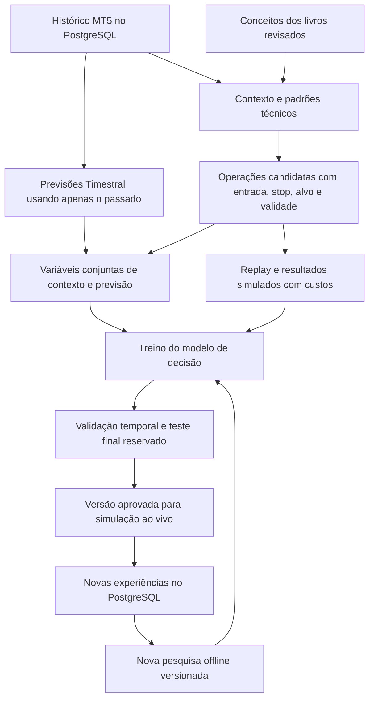

# Aurelia FX — plano integrado de operação e treinamento

> Atualização de escopo em 21/10/2026: o usuário pediu ciclo autônomo em conta demo, sem aprovação por hipótese. O fluxo vigente está em [CICLO_AUTONOMO_DEMO.md](CICLO_AUTONOMO_DEMO.md). As etapas de promoção manual descritas abaixo pertencem ao plano anterior e não são pré-requisito da pesquisa demo atual.

Data: 20/10/2026. **Plano de readequação aprovado, em implementação**, baseado na inspeção do código
e da documentação. Este plano não habilita ordens nem declara treino concluído.
As fases abaixo são a sequência proposta de entregas, não funcionalidades já
disponíveis. A interface atual ainda precisa ser reorganizada.

## 1. Objetivo do produto

O usuário escolhe o lote e inicia o agente. O sistema prepara os últimos
30 dias do ativo, verifica a versão de estratégia/modelo e passa a analisar
o mercado. A primeira versão completa executa operações simuladas ao vivo.
A execução em conta demo é uma etapa posterior; conta real permanece bloqueada.

O primeiro recorte será EUR/USD, execução M5 e contexto M15/H1/H4/D1,
reaproveitando a captura M1/M5/M15/M30/H1/H4/D1. Uma implementação completa e
mensurável desse recorte precede expansão para outros ativos e períodos.

**Iniciar não significa treinar do zero a cada clique.** Sem versão validada,
o sistema prepara o treinamento inicial e informa esse estado. Com uma versão
validada, atualiza dados e inicia o modo autorizado. Falha ou amostra
insuficiente mantém a operação bloqueada e apresenta o motivo.

## 2. Onde estamos de fato

| Componente | Situação constatada | Papel na próxima entrega |
|---|---|---|
| Ponte MT5, validação UTC e reconexão | Implementados | Fonte de dados |
| Importação de 30 dias e PostgreSQL | Implementados | Base histórica e memória |
| Regime, estrutura, tendência, price action e evidências V4 | Implementados em módulos | Variáveis observáveis e critérios da estratégia |
| Catálogo dos livros | Conceitos e referências parciais; há itens `needs_review` | Base para regras verificáveis, sem presumir leitura integral ou validade |
| Timestral | Inferência local M5, quantis e avaliação; não altera decisões V4 | Uma entrada adicional do modelo de decisão |
| Replay e simulador com custos | Implementados | Gerar resultados de operações candidatas |
| Learner legado em `learning.py` | Regressão logística com contrato antigo de 22 variáveis | Referência reaproveitável; não é integração V4 + Timestral pronta |
| Aprendizado integrado e versão operacional | Faltam | Entrega central deste plano |
| Painéis, sessões e revisão humana | Implementados | Recursos avançados e opcionais |
| Executor MT5 e reconciliação de posições | Não implementados no fluxo V4 | Etapa demo posterior |

O replay mensal documentado em `historical_validation.md` produziu zero
operações em desenvolvimento/validação e 4.986 NO_TRADE. Isso mostra um
problema a investigar na elegibilidade/contexto; não demonstra treinamento
de entradas, rentabilidade ou qualidade de previsão. Não é uma consulta nova
ao estado atual da VM. O código atual carrega pesos Timestral e chama
`forecast`; não realiza fine-tuning.

## 3. Como os componentes se unem

### Livros

Cada conceito utilizado terá referência revisada, definição calculável,
condição de aplicação, confirmação e invalidação. Por exemplo: tendência
entre períodos, retorno a uma zona, rompimento confirmado e distinção entre
faixa e tendência. Limiares de engenharia serão identificados como escolhas
do projeto, não frases atribuídas ao autor. Conceitos contraditórios serão
separados; referências sem verificação não ganham aprovação automaticamente.

Não se treina uma rede de preço simplesmente anexando PDFs. Os documentos
orientam hipóteses e variáveis; os dados e resultados medem sua utilidade.

### Timestral

Começar com a revisão instalada dos pesos fixa. Para cada instante histórico,
gerar previsões usando somente candles anteriores disponíveis, registrando
mediana, amplitude/incerteza e horizonte. Testar se essas previsões acrescentam
resultado ao sistema técnico. Os quantis não são probabilidade de trade vencedor.

A implementação atual usa até 256 candles M5 como contexto por previsão;
capturar 30 dias não significa que uma chamada já consumiu todo o mês. O mês
serve para estatísticas, sucessivas previsões históricas e experiências.
Contextos maiores e covariáveis são experimentos futuros controlados.

O repositório oficial fornece inferência. Fine-tuning dos pesos não é entregue
pela integração atual e será pesquisa separada, dependente de amostra e
recursos. Referência: https://github.com/mistralai/timestral

### Modelo de decisão

Treinar inicialmente um filtro simples e auditável sobre as operações
candidatas. Entrada: contexto V4, características do setup, custos e previsão
Timestral. Saída: estimativa calibrada de resultado da operação sob stop,
alvo e prazo definidos. Examinar também retorno líquido esperado e incerteza;
um score de confluência não será apresentado como probabilidade.

O esquema novo será versionado; não se preenchem variáveis V4 ausentes com
zeros para encaixar no learner legado. A implementação deve preservar o
protocolo temporal e separar o modelo candidato da versão em uso.

## 4. Sequência das entregas e critérios de conclusão

| Fase | Entrega | Evidência necessária para concluir |
|---|---|---|
| 1 — Fluxo único e interface | Lote, modo simulado inicial, Iniciar/Pausar/Parar e etapas de execução | Botão dispara preparação real; estados vêm do backend; erro mostra causa e ação |
| 2 — Histórico preparado | Atualizar os 30 dias e validar fonte, períodos, cobertura e UTC | Identidade e versão dos dados, período efetivo e relatório de qualidade no banco |
| 3 — Estratégia pesquisável | Um setup inicial de continuação após pullback/retorno, com regras explícitas e features V4 + Timestral | Contrato de entrada/saída e ligação aos conceitos revisados; elegibilidade auditada sem exigir modelo previamente treinado |
| 4 — Simulação histórica | Percorrer os dados cronologicamente e simular candidatos sem depender do filtro ainda não treinado | Cada entrada tem contexto congelado, custos, saída e resultado; contagem real de candidatos e motivo das exclusões |
| 5 — Treino inicial integrado | Construir dataset conjunto e ajustar um modelo candidato | Versão, amostras, período, variáveis, parâmetros e métricas persistidos; amostra insuficiente impede conclusão |
| 6 — Validação independente | Comparar técnico sem Timestral, Timestral isolado sob regra fixa e sistema combinado | Comparação líquida com amostra/custos comparáveis, teste temporal e relatório de aprovação/reprovação |
| 7 — Simulação ao vivo | Usar versão aprovada em novos candles e simular operações | Decisões explicadas, posições simuladas gerenciadas, resultados persistidos e comportamento após falhas documentado |
| 8 — Execução demo | Integrar envio, confirmação, stops, reconciliação e parada no MT5 | Conta demo verificada; ausência de duplicatas e posições órfãs nos cenários de teste; risco respeitado |

Não desenvolver novas telas diagnósticas independentes antes de fechar o
caminho histórico → candidatos → resultados → treino → versão validada.
A interface da fase 1 deve mostrar claramente as fases ainda não implementadas,
sem simular progresso ou dizer que o agente está treinado.

### Como resolver o início sem operações

O gerador de candidatos da fase 3 não pode depender da aprovação de um modelo
que ainda precisa desses resultados para ser treinado. Ele usa regras fixadas
antes da simulação. Os candidatos elegíveis geram experiências de pesquisa
independentemente do futuro score aprendido, respeitando as condições de cada
experimento e os limites do simulador.

Se continuar produzindo zero entradas, a entrega será diagnóstico das
condições que impediram candidatos e uma proposta versionada de correção.
Não relaxar filtros silenciosamente nem fabricar trades para atingir amostra.
Propostas de estratégia seguem para novos experimentos separados.

## 5. Protocolo de treino e avaliação

- **Dados iniciais:** últimos 30 dias são o mínimo de contexto solicitado,
  não garantia de amostra suficiente para aprovação. Buscar janela maior no
  MT5 quando necessário e disponível, indicando limites do terminal.
- **Aquecimento:** separar o passado necessário às features e ao contexto
  antes do primeiro exemplo. Se o teste exigir estatísticas de 30 dias no
  instante simulado, capturar também esses 30 dias anteriores à janela de
  treino/teste. Não usar o resumo do mês inteiro para decidir no começo dele.
- **Experiências:** features e previsões disponíveis antes da entrada;
  resultado apenas depois da saída. NO_TRADE não vira perda. Repetir replay
  não multiplica amostras independentes; sobreposição temporal será registrada.
- **Execução simulada:** entrada no próximo preço negociável após o sinal,
  stop, alvo, prazo, spread, comissão e slippage. Quando OHLC não resolver a
  ordem entre stop e alvo, usar dados mais finos ou regra conservadora declarada.
  Não apresentar precisão de execução que os dados não suportam.
- **Separação temporal:** desenvolvimento, validação e teste final reservado,
  com remoção de exemplos cujas saídas cruzam fronteiras. Treinar normalização,
  parâmetros e calibração exclusivamente nas subdivisões de treino apropriadas.
  Usar walk-forward e período de separação compatível com os horizontes.
- **Comparação justa:** regras técnicas e controles de risco comparáveis;
  relatar resultado por operação e por período, exposição, volume de candidatos
  e operações rejeitadas. Não misturar acerto de direção com acerto de trade.
- **Métricas:** resultado líquido, expectativa por operação, drawdown, fator
  de lucro, acerto, amostra, risco e calibração das probabilidades, com
  incerteza. Comparar o ganho incremental de Timestral e do filtro aprendido.
- **Aprovação:** definir antes do experimento limites de risco, suficiência
  amostral e critérios econômicos/estatísticos no protocolo versionado. Não
  escolher esses limites olhando o teste final. Cem exemplos do learner legado
  não equivalem a certificação estatística da estratégia nova.
- **Reserva final:** dados já inspecionados não voltam a ser inéditos por nova
  divisão. Alterações após consultar o teste exigem outro período reservado.
- **Novas versões:** novas experiências alimentam candidatos offline. Não
  mudar pesos ou regras da versão ativa durante a operação. Mostrar comparação
  e aprovação antes da substituição. Revisão humana é opcional, não requisito
  para o agente aprender com resultados simulados.

## 6. Comportamento ao clicar em Iniciar

1. Validar lote conforme contrato do símbolo, modo autorizado e limites de risco.
2. Conectar à fonte e atualizar/carregar o histórico no PostgreSQL, reutilizando
   os dados já válidos. Evitar baixar novamente todo o mês sem necessidade.
3. Validar a base e apresentar data inicial/final e cobertura.
4. Procurar versão aprovada e compatível com ativo, período e esquema.
5. Sem versão: executar o pipeline inicial quando implementado; exibir
   treinamento, validação, reprovação ou amostra insuficiente com números reais.
6. Com versão válida: passar a analisar novos candles no modo autorizado.
7. Candidato aprovado por contexto, previsão/modelo e risco gera operação
   simulada; caso contrário, informar o motivo de esperar.

O lote escolhido será usado nas simulações e na execução futura. Não é
sinônimo de risco: lote, stop, saldo, moeda da conta e contrato determinam a
exposição. Se ultrapassar o limite configurado, bloquear a entrada e explicar;
não aumentar lote nem modificar o stop para forçar aceitação.

## 7. Interface proposta

### Operação — tela principal

- **Cabeçalho:** EUR/USD, lote, modo Simulado/Demo e Iniciar/Pausar/Parar.
- **Progresso:** Conectando → Histórico → Treino inicial, se necessário →
  Validando → Analisando → Em posição / Aguardando oportunidade.
- **Estado atual:** uma frase objetiva com o motivo e a próxima ação.
- **Gráfico:** preço, previsão identificada como estimativa e níveis da
  operação quando existentes. Evitar todos os indicadores por padrão.
- **Última decisão:** Comprar/Vender/Aguardar, horário, razão, entrada,
  stop, alvo e risco quando aplicáveis. Distinguir proposta de ordem confirmada.
- **Resumo:** posição, resultado realizado, resultado aberto e operações do dia.

### Treinamento — tela secundária

Período usado, exemplos disponíveis, operações simuladas, etapa atual,
versão candidata/ativa, métricas em dados não usados no ajuste e explicação
de aprovação/reprovação. Sem percentuais fictícios de “inteligência”.

### Avançado

Histórico detalhado, evidências, Timestral, revisão humana, sessões auditáveis,
parâmetros e logs. Remover exigência de token e justificativa do fluxo normal
do usuário por meio de autenticação/configuração adequada; manter controles
protegidos. A reformulação de autenticação precisa ser implementada antes
de ativar comandos operacionais. O token atual não será simplesmente removido
dos endpoints nem embutido em JavaScript.

## 8. Primeiro marco de produto

**Escolher lote → iniciar preparação → importar 30 dias → gerar e simular
candidatos → treinar e validar uma versão → apresentar o relatório → analisar
novos candles e realizar operações simuladas.**

Concluir fases 1 a 7 forma o primeiro fluxo completo. Cada fase deve ter
resultado verificável e estado visível; instalação de biblioteca ou novo
painel isolado não será tratada como conclusão do agente. O avanço à demo
depende da fase 8; esta proposta não autoriza conta real.

## 9. Próxima entrega concreta

Começar pelas fases 1 e 2: substituir a experiência principal por um fluxo
único que chama a preparação existente e mostra o estado real. Em paralelo
de escopo, documentar o contrato de features/setup da fase 3 antes de treinar.
Mostrar explicitamente **“Treinamento integrado ainda não disponível”** até
as fases 3 a 6 estarem prontas. Depois entregar o ciclo de pesquisa até simulação
ao vivo, em ordem, sem vender a tela inicial como agente operacional concluído.
