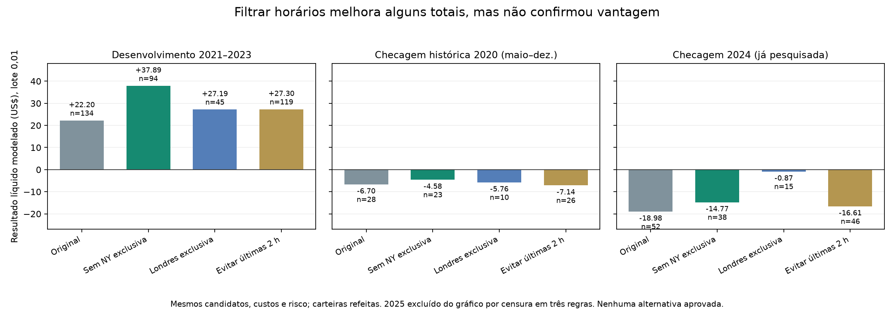

# Pesquisa de horários e alternativas H1

## Objetivo

Encontrar evidência de vantagem após custos, comparando carteiras completas.
A pesquisa usa as literaturas locais como fundamento conceitual e mede as
regras concretas no histórico EUR/USD. Não há demonstração de uma estratégia
globalmente ótima nem garantia de lucro futuro.

## Fundamento nas referências

Foram consultados novamente trechos do **Manual do Pullback** (páginas PDF 5,
10 e 13), **Wyckoff 2.0** (32–33) e **Trading in the Zone** (130, 133–134).
O manifesto `data/knowledge/literature_families.json` preserva as referências
adicionais de Pring, Brooks, Livermore e SMC já usadas para as quatro famílias.
Os oito arquivos foram verificados por SHA-256. A revisão é de seções
selecionadas, não de todos os livros na íntegra.

- Pullback: localização da entrada, estrutura preservada e retomada são
  distintos de perseguir preço ou encurtar o stop para caber uma operação.
- Wyckoff: comportamento posterior e contexto do desequilíbrio importam;
  classificar um extremo isoladamente não estabelece uma vantagem.
- Douglas: variáveis e risco devem ser definidos e os resultados avaliados
  em séries. O exercício psicológico do livro não comprova rentabilidade de
  uma regra técnica específica.

Os horários Londres/Nova York, o limite de duas horas e os parâmetros
EMA/ATR/alvo são hipóteses de engenharia. Não são prescrições exatas dos autores
nem provas de que essas janelas sejam melhores para Forex.

## Etapa 1 — quatro regras de horário

| Regra | Novas entradas permitidas |
|---|---|
| Referência | Londres 08–17 ou Nova York 08–17 |
| Excluir Nova York exclusiva | Londres ativa, incluindo a sobreposição |
| Somente Londres | Londres ativa e Nova York inativa |
| Evitar duas últimas horas | Ainda existe sessão ativa duas horas após a entrada |

São horários locais de cada mercado, com seus fusos e horário de verão.
O filtro atua **antes** da simulação de entrada. A posição já aberta mantém
a saída original; não é encerrada quando termina a janela de novas entradas.
Não foram removidas operações perdedoras de uma tabela pronta.

Regras preservadas: lote 0,01, saldo inicial US$ 10 mil, limites de risco,
spread máximo, número de operações, candidato H1, contexto H4, preços M5
originais, entrada na abertura seguinte, stop primeiro em ambiguidade intrabar,
alvo e encerramento cinco minutos antes do fim da sessão.

Custos normais: spread histórico, slippage 0,2 pip e comissão assumida de
US$ 35 por milhão por lado. Estresse: spread × 1,5 e slippage 0,4 pip,
preservando os alvos. A API demo mostrou seis execuções EUR/USD, totalizando
0,06 lote, com comissão, taxas e swap iguais a zero. É uma amostra pequena,
não confirmação de tarifa futura; a comissão conservadora da pesquisa foi mantida.

A [documentação de taxas da ThinkMarkets](https://support.thinkmarkets.com/hc/en-gb/articles/25861919173649-Trading-fees)
distingue Standard sem comissão de ThinkZero com comissão. A
[tabela ThinkZero](https://support.thinkmarkets.com/hc/en-gb/articles/22387032763921-ThinkZero-account-commission)
informa US$ 7 por lote de ida e volta em conta USD, equivalente à hipótese de
US$ 35 por milhão por lado usada aqui. A API consultada não identificou o
tipo da conta; não se deve afirmar que essa tarifa se aplica ao usuário.
Evidências e limitações estão em `data/knowledge/broker_cost_evidence.json`.
Um cenário sem comissão precisa ser outro experimento com carteira refeita,
pois pode alterar vetos de risco e entradas, não apenas o lucro contabilizado.

### Escolha congelada antes da checagem adicional

Em 2021–2023, as alternativas precisavam de pelo menos 50 operações encerradas,
líquido positivo, fator de lucro ≥ 1,1, resultado positivo sob estresse e
ausência de censura/bloqueio/posição pendente. A escolha usa a maior expectativa
líquida por operação, com desempate determinístico.

| Regra em 2021–2023 | Encerradas | Líquido (US$) | Fator de lucro | Líquido estressado (US$) |
|---|---:|---:|---:|---:|
| Referência | 134 | +22,20 | 1,18 | +10,85 |
| Excluir Nova York exclusiva | 94 | +37,89 | 1,39 | +30,45 |
| Somente Londres | 45 | +27,19 | 1,58 | +23,78 |
| Evitar duas últimas horas | 119 | +27,30 | 1,24 | +17,65 |

**Escolhida no desenvolvimento: excluir Nova York exclusiva.** Somente Londres
não cumpriu o mínimo de operações; seu fator de lucro maior não autorizou
diminuir esse mínimo depois de ver os resultados.

### Resultado dos períodos adicionais

| Regra | 2020 maio–dezembro (US$) | 2024 (US$) | 2025 (US$) |
|---|---:|---:|---:|
| Referência | −6,70 | −18,98 | Indeterminado |
| Excluir Nova York exclusiva | −4,58 | −14,77 | Indeterminado |
| Somente Londres | −5,76 | −0,87 | −25,35 |
| Evitar duas últimas horas | −7,14 | −16,61 | Indeterminado |

A alternativa escolhida teve 23 operações em 2020, fator de lucro 0,82 e
resultado estressado de −US$ 6,72. Em 2024, teve 38 operações, fator 0,60 e
resultado estressado de −US$ 17,71. Ela reprovou os dois períodos mesmo com
amostra suficiente para a checagem de pelo menos 20 operações.

Em 2025, três regras mantêm uma posição censurada na lacuna de 05/09 e não
têm resultado anual confiável. Somente Londres não carregou aquela posição,
mas perdeu US$ 25,35 em 11 operações e não atingiu o mínimo de amostra.
Evitar a lacuna por acaso não é critério de seleção.

**Conclusão da etapa 1:** excluir Nova York exclusiva melhora alguns totais,
mas não resolve a inconsistência da candidata. Nenhuma regra foi aprovada.



### Origem e limites

- Protocolo registrado antes dos novos resultados:
  `2be30ccf58ecdb26d43b1793b4a1201974d6822466004ee6e1f19a93769161a3`.
- Relatório `agent_h1_hours_experiment`:
  `4d07621604cee80a6f24e9c39015d6adb5ef325383f87a5445f3ef6639129078`.
- Reserva 2020 congelada: 56.353 candles incluindo aquecimento em abril,
  cobertura de 99,35% no calendário semanal. A escolha foi gravada antes dos
  resultados de 2020. A reserva é uma checagem histórica anterior adicional,
  não uma validação prospectiva ou garantia de independência estatística.
- 2021–2026 já haviam orientado pesquisas e a escolha dessas janelas. Há
  múltiplas comparações e risco de seleção. Os controles anuais e de
  desenvolvimento reproduziram exatamente as carteiras originais.
- Nenhum preço foi preenchido ou interpolado.

## Etapa 2 — outras famílias da literatura

O protocolo separa correção e retomada (`trend_pullback`), falha no extremo de
faixa (`range_failure`) e reversão confirmada (`reversal_shift`). Cada uma é
comparada no horário original e sem Nova York exclusiva, totalizando seis
alternativas. Os parâmetros já existentes de cada família permanecem fixos.

As definições admitem contextos diferentes de tendência, inclusive reversões
contrárias ao contexto superior em pesquisa. Não há alteração do agente ativo.
O limite de perda e os demais controles de risco continuam iguais.

A seleção considera apenas 2021–2023, com mínimo de 50 operações, lucro líquido,
fator ≥ 1,1, estresse positivo e carteira sem exposição desconhecida. Os demais
períodos são checagens separadas. Para esta segunda etapa, 2020 já estava
alocado à etapa de horários; não é apresentado como novo período independente.

Protocolo `agent_h1_family_protocol`:
`51d2f065899ac668246235d25c43a703a630836b63822c4673bd7dc62a0f5f03`.
Relatório `agent_h1_family_experiment`:
`f476ae44411ba1a47c5df9e064fc2a74adc067d793b4a9565040991d7bb40fd5`.

| Família / horário em 2021–2023 | Encerradas | Líquido (US$) | Estresse (US$) |
|---|---:|---:|---:|
| Correção e retomada / original | 470 | −53,46 | −95,35 |
| Correção e retomada / sem NY exclusiva | 394 | −30,22 | −67,91 |
| Falha de faixa / original | 17 | −18,35 | −13,46 |
| Falha de faixa / sem NY exclusiva | 13 | −16,96 | −11,79 |
| Reversão / original | 9 | +17,44 | +16,60 |
| Reversão / sem NY exclusiva | 8 | +17,34 | +16,59 |

**Nenhuma alternativa foi selecionada.** As duas famílias mais frequentes
ficaram negativas; as reversões positivas não atingiram o mínimo de 50
operações. O fator de lucro alto da reversão não corrige essa insuficiência.

Em 2024, correção/retomada continuou negativa (−US$ 32,46 no horário original),
e reversão somou apenas +US$ 0,32 em seis entradas, passando a −US$ 0,19 sob
estresse. Em 2025, reversão perdeu US$ 9,32 em cinco entradas; em 2020, perdeu
US$ 8,90 em 11 entradas. Logo, não há confirmação de sua vantagem nos outros períodos.

As carteiras de correção/retomada em 2020 e 2025 tiveram exposição censurada e
líquido total indeterminado. Os resultados parciais não foram tratados como
resultado anual. A faixa teve poucos negócios e não sustentou vantagem.
O estresse pode vetar entradas pelo risco e, por isso, às vezes reduzir uma
perda por mudar o conjunto executado; isso não é demonstração de robustez.

Os sinais de rompimento/reteste dos cinco anos foram reproduzidos exatamente
como controle. As quatro famílias H1 de 2026 também reproduziram integralmente
os sinais do experimento original. Não houve alteração silenciosa da definição
para fazer uma variante ganhar. O resultado se refere a essas implementações
concretas; não invalida todas as estratégias possíveis dos autores.

85 testes direcionados aprovados, incluindo horário de verão, permanência da
posição após o fim da janela de entrada, seleção sem redução do mínimo de
amostra e comparação futura sem inserir operações anteriores ao registro.

O código original dessas duas etapas foi publicado no commit `ef24a6a`.
Depois, o gerador foi extraído para `run_literature_validation.py`, com perfil
de timeframe explícito; `run_h1_family_validation.py` permanece como entrada
compatível. Os hashes históricos referem-se ao código preservado naquele commit.

## Etapa 3 — comparação ampliada em M15

Foi concluído o protocolo
`7407ef3ece26ce511e2ba781667a9a67ae0bf7a6a395c7d68e661877334a2e02`.
Ele compara as quatro famílias em M15, cada uma nos dois horários já definidos:
original e sem Nova York exclusiva. Nenhum número de EMA, ATR, tolerância ou
risco foi otimizado a partir dos resultados.

O perfil é o mesmo da pesquisa M15 anterior: contexto H1, confirmação H1 e
macro H4. Contexto e confirmação H1 são correlacionados; não representam duas
evidências independentes. Mantêm-se as saídas em preços M5 e 24 candles de
execução como prazo nominal (72 candles M5), além do encerramento por sessão.
O veto de entradas nas últimas 24 horas de cada janela é mantido.

O período 2021–2023 é usado para seleção com os mesmos mínimos. Os resultados
de 2024, 2025 e 2020 aparecem depois como checagens históricas já expostas a
pesquisas anteriores, não como validação independente. As quatro famílias M15
de 2026 deverão reproduzir os sinais congelados da comparação original.

```powershell
.venv/Scripts/python.exe run_literature_validation.py --timeframe M15
```

Registros: `agent_m15_family_protocol`, `agent_m15_family_signals`,
`agent_m15_family_selection` e, ao concluir, `agent_m15_family_experiment`.
Relatório final `agent_m15_family_experiment`:
`01bf0ca45b97360228660d8fc38bd0483f783491cca8fe1a27f5808aabd74669`.

| Família / horário no desenvolvimento 2021–2023 | Encerradas | Líquido (US$) | Estresse (US$) |
|---|---:|---:|---:|
| Correção e retomada / original | 197 antes do bloqueio | Indeterminado | Indeterminado |
| Correção e retomada / sem NY exclusiva | 144 antes do bloqueio | Indeterminado | Indeterminado |
| Rompimento/reteste / original | 497 | −144,56 | −183,44 |
| Rompimento/reteste / sem NY exclusiva | 371 | −111,32 | −138,33 |
| Falha de faixa / original | 109 | −1,47 | −11,17 |
| Falha de faixa / sem NY exclusiva | 42 | +2,70 | −2,29 |
| Reversão / original | 53 | +6,96 | +2,79 |
| Reversão / sem NY exclusiva | 43 | +14,84 | +11,49 |

**Escolha de desenvolvimento: reversão M15 no horário original**, com fator
de lucro 1,14. A variante sem NY teve resultado maior, mas não atingiu o mínimo
de 50 negócios; não substituiu a escolha depois dos resultados.

| Checagem da reversão M15 escolhida | Encerradas | Líquido (US$) | Estresse (US$) |
|---|---:|---:|---:|
| 2024 | 18 | −3,83 | −4,98 |
| 2025 | 19 | +13,60 | +12,04 |
| 2020 maio–dezembro | 10 | −8,98 | −9,75 |

A candidata não cumpriu os critérios das checagens. O ano negativo não prova,
sozinho, que uma estratégia jamais possa ter vantagem; ele reprova o protocolo
registrado e não sustenta ativação com estas evidências. O ano positivo de 2025
também não basta para dispensar os mínimos ou escolher outro filtro depois.

Como diagnóstico posterior à seleção, a soma das seis carteiras anuais da
reversão original, incluindo apenas maio–dezembro de 2020, reúne 100 operações
e +US$ 7,75. Não é uma nova simulação de conta contínua. Sem o melhor negócio,
a soma fica em −US$ 2,34. Um bootstrap descritivo de dias com operações
(5.000 reamostragens, semente 20261023) apresentou faixa de 95% de aproximadamente
−US$ 44,20 a +US$ 62,66. Ela não é intervalo de lucro futuro nem corrige a
seleção entre várias alternativas. A margem estimada é pequena e incerta.

As quatro famílias M15 reproduziram exatamente os sinais congelados de 2026.
O relatório e os 100 hashes de implementação foram verificados no PostgreSQL.
86 testes direcionados aprovados após a generalização do gerador, incluindo
perfil M15 e disponibilidade apenas de candles fechados.

### Qualidade dos dados

As posições censuradas permanecem registradas como resultado desconhecido,
inclusive nas carteiras M15 com mais entradas. Uma consulta nova ao M1 do MT5
confirmou que os dez minutos correspondentes às duas barras M5 ausentes de
05/09/2025 também não aparecem nesse timeframe. Não foi possível reparar a
lacuna com M1; nenhum preço foi interpolado. A auditoria
`agent_h1_extended_gap_m1_check` usa a chave do relatório histórico original.

## Etapa 4 — sensibilidade ao perfil de comissão

Foi concluído um experimento separado com comissão zero,
usando os mesmos oito conjuntos M15 de sinais congelados. Ele representa a
sensibilidade compatível com as seis execuções demo observadas; não confirma
o tipo da conta nem uma tarifa futura de conta real.

Protocolo `80d2a1fa2f43cdbc36b6f084a8a46b0c16de5c92f782135c78c0efbd76fd4349`,
registrado antes dos resultados deste cenário. 88 testes direcionados passaram,
incluindo execução com comissão zero e preservação da configuração padrão
após o teste isolado.

Spread, slippage, alvos, prazo, risco e horários não mudam. O simulador é
instanciado com comissão zero apenas no processo de pesquisa; a configuração
normal de US$ 35 por milhão por lado permanece preservada. As carteiras são
refeitas porque a comissão também participa dos vetos de risco.

A seleção permanece restrita a 2021–2023 e os mínimos de amostra e checagens
não são reduzidos. Os resultados com comissão são preservados como referência.
Não haverá seleção da comissão mais favorável como se ela fosse uma variável
de mercado controlável pelo agente.

```powershell
.venv/Scripts/python.exe run_demo_fee_sensitivity.py
```

Registros `agent_demo_fee_protocol`, `agent_demo_fee_selection` e
`agent_demo_fee_experiment`. Relatório concluído:
`6a65b9b9df12e3a248638dba5105b89131d378465722758fa8bc727911bf9884`.

A escolha continuou sendo reversão M15 no horário original:

| Período, comissão zero | Encerradas | Líquido (US$) | Estresse (US$) |
|---|---:|---:|---:|
| Desenvolvimento 2021–2023 | 53 | +10,67 | +6,50 |
| Checagem 2024 | 18 | −2,57 | −3,72 |
| Checagem 2025 | 19 | +14,93 | +13,37 |
| Checagem 2020 maio–dezembro | 10 | −8,28 | −9,05 |

Nenhuma checagem cumpriu todo o protocolo. O resultado positivo em 2025 ficou
com 19 operações; 2024 e 2020 também foram negativos. Não houve redução do
mínimo depois dos resultados.

Na falha de faixa, retirar comissão alterou vetos de risco e aumentou de 109
para 126 o número de negócios do desenvolvimento; o líquido piorou de
−US$ 1,47 para −US$ 10,72. Portanto, somar as comissões aos negócios antigos
teria produzido uma conclusão errada sobre a carteira sem comissão.

O perfil de comissão é um custo a identificar, não um parâmetro para escolher
conforme dê mais lucro. Os dois perfis permanecem separados, sem confirmação
do tipo de conta e sem extrapolar seis execuções demo para uma tarifa real.

## Correção da inicialização prospectiva

A auditoria identificou um candle descartado entre o seed e o fluxo novo da
primeira versão do observador: último seed às 16:25 UTC e primeira barra do
arquivo novo às 16:35 UTC. A barra de 16:30 estava se formando na captura
inicial e foi indevidamente excluída quando fechou. A diferença de 10 minutos
reiniciava artificialmente o contexto.

Os estudos anteriores não tinham operações nem posições simuladas abertas.
Seus registros foram preservados e marcados como inadequados para validação
do contexto, em `agent_shadow_startup_audit`. Nenhuma operação antiga foi
inserida retroativamente para melhorar o resultado.

A versão corrigida continua a partir da última barra efetivamente presente
no seed, incluindo a barra que estava em formação assim que ela fecha. Uma
checagem real confirmou seed às 18:25 UTC, primeira barra nova às 18:30 UTC
e continuidade de cinco minutos. O contexto preservou 213 candles H4 e 300
H1; D1 tinha 39, ainda abaixo do mínimo de 60, explicitamente sem inferir
neutralidade a partir dessa falta.

Novo feed prospectivo:
`20a06833abbd6ddb7edfde7dba6a95e4841f39af6cb3f91cbc6cad8057ebff6a`.
Novo comparador de horários:
`4eb88a647c9e4ff16852cee79a16232d4051ac32deae9fc1031fcb4d4e0f4e10`.
Ambos iniciados em **23/10/2026 às 15:35 de Brasília** (18:35 UTC).
Os consumidores passam a localizar o feed pelo hash da implementação atual;
se ele ainda não estiver registrado no login, aguardam e tentam novamente.
Não continuam silenciosamente ligados à versão antiga.

Somente os dois observadores de pesquisa foram reiniciados. Agente principal,
ponte de gráfico e terminal permaneceram em execução. A verificação real da
continuidade foi registrada em `agent_shadow_startup_verification` pela chave
do novo feed. Novos testes cobrem a barra em formação, a retomada sem duplicação
e a corrida de inicialização entre produtor e consumidor.

## Observação M15 em preços novos

A candidata de desenvolvimento também ganhou um observador separado,
**exclusivamente de pesquisa**, já que não passou pelas checagens históricas.
Ele compara a mesma reversão M15 nos perfis de comissão zero e conservador,
ambos com custos normais e agravados. Não altera a escolha após poucos ganhos.

Tarefa: `AgenteTrader-M15StrategyShadow`. A versão atual iniciou em
**23/10/2026 às 16:00 de Brasília** (19:00 UTC). Protocolo:
`803436531a5e31359fd3ccd5a20bd950ac818067ff7f9dd922ec7f28f1801525`.
O worker reutiliza o arquivo já coletado, respeita o fechamento M15 e exclui
sinais recebidos com atraso. Não faz uma nova conexão ao terminal nem envia
ordens. Resultados em `agent_m15_strategy_shadow_cycle`.

Cada proposta preserva cenário, direção, stop, alvo, contexto e horário da
primeira captura em `agent_m15_strategy_signal`. Cada encerramento tem um
registro por perfil de custo em `agent_m15_strategy_outcome`, vinculado ao
mesmo identificador da proposta. Atualizações posteriores não duplicam a
experiência; os ciclos guardam resumos em vez de repetir todas as operações.
Quatro simulações de custo do mesmo evento não são quatro experiências
independentes de mercado. Esses registros apoiam avaliação e pesquisa;
não significam atualização automática dos pesos ou da estratégia ativa.

A versão inicial M15, iniciada às 15:45 de Brasília sob identificador
`1393593fa2cb88220da7895a67a0bef8394e7d42eb77b047c281cf5f0b663e37`,
foi substituída antes de qualquer operação para acrescentar esse diário
estruturado e evitar repetição de negócios nos snapshots. Os registros de
zero operações foram preservados em `agent_shadow_version_transition`.

O comando `h1_research_status.py` mostra os resultados e se o mínimo futuro de
50 encerramentos foi atingido com líquido positivo, fator ≥ 1,1, estresse
positivo e carteira sem exposição desconhecida. Cumprir esse mínimo não
promove automaticamente uma estratégia nem comprova lucro futuro.

```powershell
.venv/Scripts/python.exe run_m15_strategy_shadow.py
powershell.exe -NoProfile -ExecutionPolicy Bypass -File install_m15_strategy_shadow_startup.ps1
```

**Situação:** nenhuma das alternativas desta rodada está aprovada para
substituir a estratégia do agente. Os resultados históricos e as hipóteses
estão persistidos, e a evidência futura passa a ser coletada automaticamente.
Nenhum dos experimentos promove modelos, muda pesos do Timestral ou envia
operações novas à conta demo.

92 testes direcionados aprovados ao final da implementação, incluindo
persistência sem duplicação, perfis de custo separados e a continuidade do
contexto após iniciar os observadores. O objetivo de encontrar vantagem
consistente continua em aberto; os ganhos históricos isolados não foram
apresentados como uma estratégia aprovada.

## Observação prospectiva automática — registro inicial preservado

O registro abaixo descreve a versão inicial, substituída após a auditoria do
candle ausente. Para a coleta válida atual, use os identificadores e horários
da correção acima; os registros antigos não foram apagados.

As quatro regras de horário foram registradas para comparação simulada em
preços novos a partir de **23/10/2026 às 14:35 de Brasília** (17:35 UTC).
A escolha do desenvolvimento fica fixa; não será substituída automaticamente
pelo grupo que parecer melhor em poucos negócios futuros.

A tarefa `AgenteTrader-H1HoursShadow` reutiliza o arquivo imutável de candles
e os sinais capturados no prazo pelo observador H1 existente. Não abre outra
conexão com o MT5 nem envia ordens. Mantém uma carteira por regra, com custos
normais e estressados, posições e exposição censurada preservadas após reinício.

Protocolo `agent_h1_hours_shadow_protocol`:
`213e1df89e58d4fb12f285743992cd9f915941fca6303245142db984893a384c`.
Os resultados são simulações com preços e custos modelados, não execuções
confirmadas pela corretora. A coleta continua enquanto Windows, MT5, o
observador H1 e PostgreSQL estiverem disponíveis; o navegador pode ficar fechado.

## Consultar e reproduzir

```powershell
.venv/Scripts/python.exe h1_research_status.py
.venv/Scripts/python.exe run_h1_hours_experiment.py
.venv/Scripts/python.exe run_h1_family_validation.py
.venv/Scripts/python.exe run_h1_hours_shadow.py
```

Os experimentos novos registram protocolos e resultados no PostgreSQL. Repetir
o runner cria outra execução registrada; não acrescenta dados futuros por si só.
O observador contínuo é a parte que acompanha preços novos. Os JSONs completos
ficam em `data/reports/`, fora do Git. A coleta prospectiva não promove nenhuma
estratégia nem altera pesos do Timestral.
