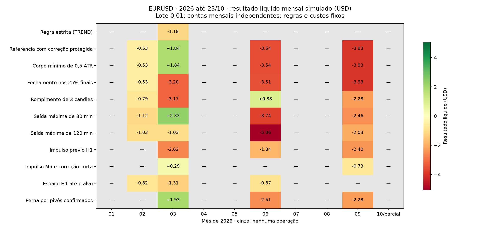

# Histórico de 2026 — Agente Trader - IA

## Escopo

Recaptura do EURUSD no terminal MT5 em 23/10/2026. O período solicitado começa
em **01/01/2026 UTC** e termina no instante da captura; novembro e dezembro
ainda não estão disponíveis. Dezembro de 2025 serve exclusivamente como
aquecimento dos indicadores, estruturas e agregações.

O estudo anterior já analisava 335 dias, incluindo parte de 2025. Restringir
o teste a 2026 não aumenta sua duração. As 25 operações executadas no estudo
anterior já pertenciam a 2026; os 17 sinais de 2025 não geraram operações
executadas. Esta entrega recaptura a fonte,
regenera todos os sinais e acrescenta uma avaliação por mês.

O teste avalia as **hipóteses técnicas fixas** dos estudos anteriores. Ele não
reproduz integralmente o robô adaptativo, não treina os pesos do Timestral e
não autoriza automaticamente mudanças no agente em execução.

## Dados e método

- Fonte: MT5, EURUSD, M5, somente candles fechados, contrato UTC validado.
  A origem registra offsets históricos de duas e três horas; a conversão
  existente trata cada data e os testes não reaplicam o offset atual ao passado.
- 66.644 candles arquivados: 6.020 de aquecimento e 60.624 de 2026.
- Primeiro candle de aquecimento: 02/12/2025 00:00 UTC.
- Último candle: 23/10/2026 13:55 UTC.
- Instante de corte: 23/10/2026 14:03:13 UTC.
- Cobertura estimada do arquivo completo: 99,05%. O calendário semanal usado
  no cálculo não modela feriados; cobertura não é garantia de ausência de gaps.
- Spread histórico presente em todos os candles; média de 1,28 pip no arquivo
  completo, incluindo aquecimento.
- Registros imutáveis no PostgreSQL, verificados contra a nova captura e
  congelados antes do cálculo de resultados.
- Direção H4/H1 confirmada, mesma geometria de entrada/stop/alvo, lote 0,01,
  capital inicial de US$ 10.000, custos e limites de risco anteriores.
- Custos do simulador: spread observado, slippage de 0,2 pip por execução
  a mercado e comissão de US$ 35 por milhão por lado. Swap não é modelado.
- Nenhuma combinação nova de filtros, busca de parâmetros ou ajuste após
  conhecer os resultados.
- Carteira contínua no período total e contas independentes por mês. A soma
  dos meses não precisa coincidir com a carteira contínua: os limites de cada
  mês fecham a janela de novas entradas duas horas antes do fim do período.
- Gaps inesperados seguem a política de invalidação/censura do simulador;
  nenhum resultado desconhecido deve ser contado como ganho ou perda confiável.

## Comparações fixadas antes do resultado

1. Regra estrita: apenas os sinais TREND aceitos pela política original.
2. Referência experimental: regra estrita ou correção protegida, sem filtro extra.
3. Corpo mínimo de 0,5 ATR.
4. Fechamento nos 25% finais do candle.
5. Rompimento dos três candles anteriores.
6. Saída máxima em 30 minutos.
7. Saída máxima em 120 minutos.
8. Impulso prévio em H1.
9. Impulso M5 em janela fixa e correção de até 50%.
10. Espaço estrutural H1 até o alvo.
11. Perna M5 por pivôs confirmados e correção de até 50%.

Exceto nas duas variantes de duração, permanece a saída máxima de 12 candles
M5. O descarte de novas entradas nas últimas duas horas é comum a todas as
comparações, para que o horizonte mais longo não receba menos tempo de saída.

## Limites de interpretação

A maior parte dos preços até 20/10/2026 já foi usada nas pesquisas anteriores.
As hipóteses já foram vistas nesses dados: repetir o teste não cria uma amostra
independente. Os últimos dias são uma extensão curta, insuficiente para
comprovar vantagem estatística.

A captura também inclui 22–23/10, datas do estudo prospectivo existente. Seus
registros e regras não foram alterados, mas esses preços agora foram usados
nesta investigação e não podem ser descritos como dados nunca inspecionados.
Não se deve alterar o classificador ou escolher filtros pelo resultado desta
extensão e depois alegar validação independente nesses mesmos dias.

Lucro líquido, expectativa, fator de lucro, quantidade de operações, direção,
risco e consistência mensal devem ser considerados juntos. Acerto isolado não
valida uma estratégia. Ausência de operações também não é acerto de 0%.

## Reprodução

```powershell
.venv/Scripts/python.exe run_year_validation.py --year 2026
```

Uma nova execução captura outro instante e cria outro protocolo. Para retomar
exatamente a fonte congelada desta execução, sem recapturar nem escolher dados:

```powershell
.venv/Scripts/python.exe run_year_validation.py --resume 228ece0d5f8f3294e11f8c3c7610c03b9169e47387e7cef90bdca019da8d3dc4
```

O programa recusa retomar se os arquivos de implementação registrados mudarem.
A geração de sinais tem checkpoint imutável no PostgreSQL depois de concluída.
O relatório integral fica no PostgreSQL e em `data/reports/`, fora do Git.

- Baseline: `e1b8998fd29131cd964ffbae7dee897955e5d72bac3f6f02bcc9f5f8f421e144`.
- Protocolo: `228ece0d5f8f3294e11f8c3c7610c03b9169e47387e7cef90bdca019da8d3dc4`.
- Nenhuma ordem enviada, modelo treinado ou política em produção substituída.
- 50 testes direcionados aprovados: 26 de hipóteses/ano/mês e 24 de relógio,
  captura e calendário, incluindo DST e rejeição de períodos futuros.

## Resultados consolidados

Simulações com lote 0,01, já descontados os custos descritos acima.

| Comparação | Operações | Ganhos / perdas | Acerto | Líquido (USD) | Expectativa por operação (USD) | Fator de lucro |
|---|---:|---:|---:|---:|---:|---:|
| Regra estrita (TREND) | 1 | 0 / 1 | 0,0% | -1,18 | -1,177 | 0,000 |
| Referência com correção protegida | 25 | 8 / 17 | 32,0% | -6,16 | -0,246 | 0,662 |
| Corpo mínimo de 0,5 ATR | 25 | 8 / 17 | 32,0% | -6,16 | -0,246 | 0,662 |
| Fechamento nos 25% finais | 21 | 4 / 17 | 19,0% | -11,17 | -0,532 | 0,373 |
| Rompimento de 3 candles | 16 | 6 / 10 | 37,5% | -5,36 | -0,335 | 0,575 |
| Saída máxima de 30 min | 26 | 9 / 17 | 34,6% | -4,99 | -0,192 | 0,646 |
| Saída máxima de 120 min | 24 | 4 / 20 | 16,7% | -9,15 | -0,381 | 0,540 |
| Impulso prévio H1 | 12 | 3 / 9 | 25,0% | -6,87 | -0,572 | 0,208 |
| Impulso M5 e correção curta | 3 | 1 / 2 | 33,3% | -0,44 | -0,146 | 0,677 |
| Espaço H1 até o alvo | 6 | 1 / 5 | 16,7% | -3,01 | -0,501 | 0,506 |
| Perna por pivôs confirmados | 9 | 2 / 7 | 22,2% | -2,86 | -0,318 | 0,583 |

Nenhuma das 11 comparações apresentou lucro líquido no período completo.

## Distribuição mensal

Cada célula abaixo informa **operações / resultado líquido em USD**. Outubro é parcial.

| Mês | Regra estrita | Referência com correção | Saída em 30 min | Perna por pivôs |
|---|---:|---:|---:|---:|
| 2026-01 | 0 / 0,00 | 0 / 0,00 | 0 / 0,00 | 0 / 0,00 |
| 2026-02 | 0 / 0,00 | 2 / -0,53 | 3 / -1,12 | 0 / 0,00 |
| 2026-03 | 1 / -1,18 | 12 / 1,84 | 12 / 2,33 | 4 / 1,93 |
| 2026-04 | 0 / 0,00 | 0 / 0,00 | 0 / 0,00 | 0 / 0,00 |
| 2026-05 | 0 / 0,00 | 0 / 0,00 | 0 / 0,00 | 0 / 0,00 |
| 2026-06 | 0 / 0,00 | 6 / -3,54 | 6 / -3,74 | 3 / -2,51 |
| 2026-07 | 0 / 0,00 | 0 / 0,00 | 0 / 0,00 | 0 / 0,00 |
| 2026-08 | 0 / 0,00 | 0 / 0,00 | 0 / 0,00 | 0 / 0,00 |
| 2026-09 | 0 / 0,00 | 5 / -3,93 | 5 / -2,46 | 2 / -2,28 |
| 2026-10 | 0 / 0,00 | 0 / 0,00 | 0 / 0,00 | 0 / 0,00 |



Na figura, cinza e “—” indicam ausência de operações, não meses lucrativos.
A referência operou apenas em fevereiro, março, junho e setembro: **um mês
positivo e três negativos**. Os meses sem operações não demonstram assertividade.

## O que mudou em relação à investigação anterior

- Os 90 sinais de 2026 do estudo anterior reapareceram, sem mudança na geometria dos candidatos.
- A captura acrescentou 6 sinais, todos em 23/10. Cinco ficaram dentro da janela de entrada
  e foram rejeitados por retorno/risco líquido insuficiente; o sinal das 13:45 UTC
  foi excluído pelo descarte comum das últimas duas horas.
- A referência reproduziu **exatamente as mesmas 25 operações e seus resultados individuais**.
  Não houve aumento da amostra financeira.
- Todas as 25 operações da referência foram vendas. Os resultados não demonstram
  desempenho de compras executadas. Os 96 sinais selados incluem 32 compras e 64 vendas.
- Dos 95 sinais dentro da janela da referência, 25 viraram operações, 6 foram
  ignorados por sobreposição e 64 rejeitados por risco: 59 por retorno/risco líquido
  insuficiente e 5 pelo limite diário. Os limites foram preservados.

## Interpretação

Nos 60.624 candles de 2026, o classificador registrou 33.287 estados UNKNOWN,
21.805 RANGE, 5.148 TRANSITION e 384 TREND. Entre 4.206 candidatos técnicos,
somente 1 satisfez a regra estrita e 95 passaram pela hipótese de correção
protegida. Esses números descrevem os filtros atuais; não demonstram que seja
correto relaxá-los. As restrições de direção H4/H1 e risco permaneceram iguais.

A referência teve expectativa de **−US$ 0,246 por operação**, fator de lucro
**0,662** e drawdown de patrimônio realizado de aproximadamente **0,129%**,
com capital inicial de US$ 10.000 e lote 0,01. O intervalo de Wilson de 95%
para os 32% de acerto é aproximadamente **17,2%–51,6%**, descritivo e sem
garantia de independência entre operações.

Antes dos custos registrados, o resultado bruto da referência já era negativo
(−US$ 0,662). Spread, slippage e comissão somaram US$ 5,50, levando ao líquido
de −US$ 6,162. Não há evidência para remover custos ou afrouxar o risco a fim
de transformar sinais rejeitados em entradas.

**Este teste não validou vantagem financeira das hipóteses avaliadas.**
A captura de mais candles não aumentou o número de operações executadas.
Nenhum filtro, limite de risco, política de saída ou modelo Timestral foi
ativado, treinado ou substituído em consequência dos resultados.

Para ampliar efetivamente a amostra, será necessário outro recorte que acrescente
novas operações comparáveis, além de dados futuros ainda não usados para escolher
regras. Reexecutar o mesmo histórico não acrescenta evidência independente.

## Conferências finais

- Protocolo registrado em 23/10/2026 às 14:03:30 UTC, antes dos resultados;
  processamento concluído às 14:24:13 UTC.
- 11 comparações × 11 janelas (período completo e dez meses): sem conta
  bloqueada, operação censurada, posição pendente ou duração estendida por
  fechamento de mercado nos resultados avaliados.
- Os hashes dos 96 arquivos da fotografia adicional de código e o hash do
  registro de resultados no PostgreSQL foram conferidos.
- A nova fonte foi comparada à captura do terminal e ao arquivo congelado.
- Agente permaneceu na mesma sessão e geração 4; não houve reinício de serviço.
- Relatório `agent_year_experiment`:
  `f898357a5ab80a9e9bf4d05eecda1f92754c3616239bd754c7d4b820f33086e1`.
- Conferências: `agent_year_verification`, com a mesma chave do relatório.
- Fotografia adicional `agent_year_integrity`: protocolo acima; identificador
  `214ca7f5b737da42f0e8a2bb742ae280f0542938619f6c598f85dd6f8c4ca4a9`.
