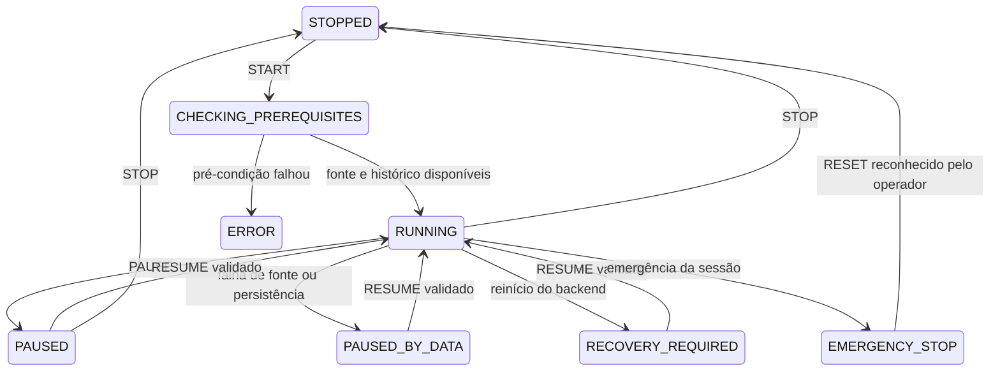

# Auditoria da conversa anexada — 20/10/2026

A proposta anexada foi comparada com o código, e não adotada como nova
arquitetura. Referência funcional preservada: Prompt Mestre V4 e suas extensões
de histórico e Timestral. Esta entrega é incremental e permanece somente leitura
para negociação.

## Já coberto; reaproveitado

| Requisito da conversa | Implementação existente |
|---|---|
| Dados fechados, UTC, reconexão e ausência de futuro | `mt5_provider`, `mt5_clock`, `source_clock`, observador e testes |
| Histórico e contexto amplo antes da operação | Coleta mensal de sete períodos, estatísticas e gate histórico |
| Features, estrutura, tendência, regime e evidências | Percepção V4, snapshots versionados e hashes |
| Risco independente | `risk.py` e limites do simulador; modelos não autorizam execução |
| Registro de decisões, inclusive espera | PostgreSQL append-only: snapshots, decisões, experiências e eventos |
| Custos, MAE/MFE e resultados simulados | `ExecutionSimulator`, replay e journal |
| Motor local sem LLM obrigatório | V4 determinístico, Timestral local; JEV continua integração opcional legada |
| Testes temporais e reserva final | Desenvolvimento/validação/holdout, versões e artefatos |
| Instância única de coleta | Advisory locks PostgreSQL já existentes |
| Previsões, métricas e versão do modelo Timestral | Tabelas Timestral, hash dos pesos e processo isolado |
| Pesquisa persistente de hipóteses | `HypothesisLab`, estudos históricos e artefatos |

Esses componentes não foram recriados. Não foram instalados FastAPI, Redis,
Celery, TimescaleDB ou novas bibliotecas de machine learning: os requisitos
incrementais desta entrega usam Python e PostgreSQL já presentes. A VM tem
recursos limitados e não precisa de outro stack para essas funções.

## Lacunas implementadas

### 1. Sessão auditável de observação

`platform_control.py` acrescenta um controlador independente, sem gateway de
ordens. Ele delimita períodos de acompanhamento humano, reaproveitando o
observador e seu lease existentes. Uma sessão não cria outro coletor.

Estados persistidos:

`RUNNING` significa **sessão em observação**, não operando na corretora. O botão
é denominado **Iniciar observação**, para representar a capacidade real do
projeto. Não foi introduzido um botão que prometa execução inexistente.

Start usa `Idempotency-Key`; a mesma chave e conteúdo retornam a mesma resposta.
Reutilizar a chave para outro comando é rejeitado. Start repetido com outra
chave durante sessão ativa retorna a mesma sessão. Advisory lock transacional
serializa comandos concorrentes, com estado e comandos no PostgreSQL.

Eventos incluem estado anterior/posterior, instante UTC, justificativa, nome
informado, origem e correlation ID. Reinício exige revisão e retomada explícita.
Falha de dados pausa a sessão; não há retomada automática de seu estado RUNNING.

Snapshots, decisões e experiências novas recebem a referência da sessão ativa.
Observações anteriores ao início/retomada não são atribuídas retroativamente.
Pausa, parada e emergência interrompem a vinculação de novas observações à
sessão. Uma gravação em curso pode concluir. A coleta automática, o histórico
mensal e a avaliação Timestral permanecem independentes, conforme o funcionamento
anterior. Emergência desta sessão **não fecha posições na corretora**.

### 2. Verificação anterior ao início

O preflight verifica heartbeat do observador, contrato UTC, tick recente,
histórico mensal do mesmo servidor e espaço livre mínimo de 256 MiB para
persistência. Exibe estratégia V4 vigente e a política somente leitura. Fonte
ou banco indisponível não produz início bem-sucedido. Modelo Timestral é evidência
opcional; não se inventou uma versão PRODUCTION ou dependência obrigatória.

Endpoints novos, atrás do proxy existente:

- `GET /api/diagnostics/platform`: estado, pré-condições e auditoria de aprendizado.
- `POST /api/diagnostics/platform/command`: START, PAUSE, RESUME, STOP,
  EMERGENCY_STOP ou RESET; aceita apenas `observe_only`.

A interface consulta o estado real do servidor. O token do operador é requerido
somente para os novos comandos, junto do CSRF/Origin já existentes. Fica no
arquivo privado `data/platform-operator.token`, ignorado pelo Git, com permissão
0600 na VM. Há cópia privada no projeto Windows para o operador preencher o
campo correspondente. O navegador não salva esse token em storage nem o coloca
na URL. Não exibir ou versionar seu conteúdo.

Essa chave representa uma credencial compartilhada de operador para sessões de
observação. O nome informado é um rótulo de auditoria, não identidade individual
verificada. Não equivale a login com RBAC completo. O acesso continua na rede
privada atual; TLS externo e contas individuais permanecem requisitos futuros.

### 3. Prontidão de aprendizado local

`learning_audit.py` inspeciona resultados simulados encerrados, custos, tempo do
resultado, contexto congelado V4 e duplicidade entre replays. Separa coortes por
ativo, estratégia, versão, configuração e versão de regime. A auditoria roda
localmente em worker independente a cada hora e fica em `project_records`.
Falha dessa auditoria não interrompe os coletores existentes.

NO_TRADE não vira exemplo perdedor; candle ou previsão sem resultado financeiro
também não vira trade. Eventos censurados, custos ausentes, contexto incompleto
ou duplicatas não são promovidos a amostras válidas. A consulta é limitada aos
5.000 resultados fechados mais recentes e informa truncamento.

O piso informativo de 100 amostras vem do learner legado; não é novo critério
de promoção. Mesmo quando esse piso for alcançado, faltará aprovar o contrato
de features V4 para o learner e um protocolo completo de treino/validação.
Esta auditoria não treina, substitui ou promove modelos.

Na inspeção inicial havia seis resultados simulados antigos e **zero amostras
compatíveis**, pois faltava contexto V4 congelado. Havia mais de 17 mil decisões
de espera; elas não foram convertidas em perdas ou usadas para inventar treino.
Essa distinção é apresentada no painel.

### 4. Backup periódico e integridade

O script original de backup foi estendido com arquivo `.partial`, verificação
gzip, publicação somente após sucesso e checksum SHA256 verificado. A saída
original com caminho do dump permanece compatível.

O timer `agente-trader-backup.timer` agenda execução diária às 03:15 UTC, com
atraso aleatório de até cinco minutos e compensação após indisponibilidade.
Usa somente o banco deste projeto e os diretórios existentes. Não há exclusão
automática de backups ou alteração em outros bancos. A retenção deve ser
administrada para evitar esgotar o disco.

Checksum e gzip não substituem restauração de teste. Cópia externa, criptografia,
WAL e teste periódico de recuperação ainda dependem de configuração e protocolo
próprios; não foram declarados como entregues.

## Itens futuros ou incompatíveis com o escopo atual

| Tema da conversa | Situação |
|---|---|
| Envio real de ordens, fills parciais e reconciliação | Não existe adaptador operacional; requer desenvolvimento separado |
| Kill switch de posições reais | Não implementado; emergência nova é da sessão de observação |
| Treino automático de candidatos V4 | Necessita amostras válidas e contrato de features aprovado |
| Promoção automática após métricas | Contraria aprovação explícita vigente do V4; não habilitada |
| Rollback de estratégia em produção | Não há estratégia executora em produção a substituir |
| RBAC completo, TLS, SSH apenas por chave | Não configurados nesta entrega; não houve alteração global da VM |
| Sincronização NTP externa | Fonte UTC é validada; o problema de alcance das fontes NTP da VM continua requisito de infraestrutura |
| Banco paralelo e nova arquitetura | Desnecessários; preservado PostgreSQL e código existentes |
| DLQ e ordens pendentes | Dependem de uma futura infraestrutura de execução; sem eventos de ordem hoje |

## Validação

Testes novos cobrem preflight, credencial ausente/incorreta, idempotência,
emergência persistente, modo live rejeitado, pausa, retomada, recuperação e
qualidade/deduplicação das amostras. Os testes PostgreSQL usam schema isolado
desfeito por rollback. A suíte completa passou com PostgreSQL e modelo local
habilitados (147 testes); a verificação adicional de resultado financeiro zero
também passou, separando empate de perda.

Na API publicada, cinco START simultâneos conservaram uma única sessão;
repetição de chave, pausa, retomada, emergência persistente e rearme passaram.
Credencial ausente/incorreta, CSRF incorreto e modo live foram rejeitados.
Reiniciar o serviço durante uma sessão exigiu RECOVERY_REQUIRED e retomada
explícita. O teste terminou em STOPPED, com observador automático saudável.

Navegador Chrome: comandos de início/encerramento, painel no gráfico e no
diagnóstico, desktop e celular, sem exceções JavaScript. Os painéis anteriores
de histórico e Timestral também passaram nos testes de regressão. O histórico
consultado estava pronto, com 41.220 candles nos sete períodos.

Na VM, o timer diário está ativo, a execução manual do serviço terminou com
Result=success e o dump passou em gzip e checksum SHA256. Nenhuma ordem foi
enviada e nenhum modelo foi treinado ou promovido nessa validação.
