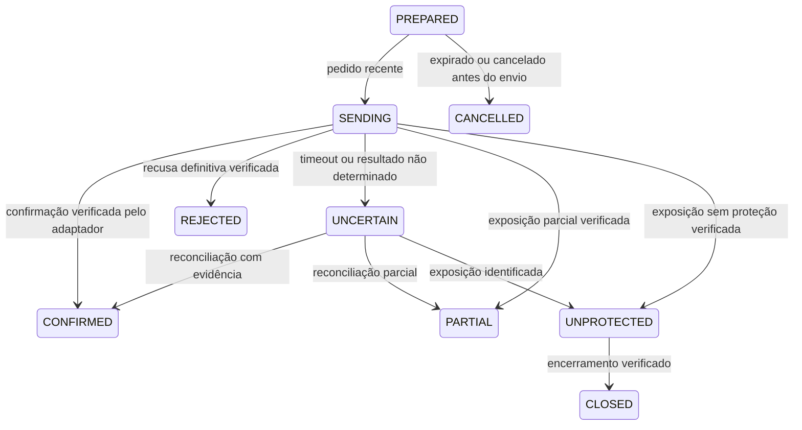

# Execução demo — protocolo durável

Atualizado em 21/10/2026. O adaptador nativo e a conta demo foram integrados ao ciclo autônomo. O pedido posterior do usuário autoriza pesquisa em conta demo sem aprovação por hipótese. Consulte [o fluxo atual](CICLO_AUTONOMO_DEMO.md). Conta real permanece bloqueada.

## Parte implementada: intenções duráveis

`demo_intents.py` implementa o protocolo de persistência antes de qualquer
chamada futura ao broker. Não importa SDK, não cria aprovação e não envia ordens.

1. Obter lock exclusivo de execução/reconciliação do projeto no PostgreSQL.
2. Preparar uma intenção com ID idempotente, pedido congelado e identificação
   da conta, aprovação, modelo, sessão e fonte.
3. Persistir `SENDING` em autocommit **antes** de permitir uma chamada ao SDK.
4. Confirmar ou registrar resultado ambíguo. Uma exceção não apaga `SENDING`.
5. Reconciliar intenções ambíguas antes de aceitar outra entrada na conta.

Estados:

Uma resposta vazia ou ausência numa consulta posterior não prova recusa. O
protocolo não permite converter `UNCERTAIN` em `REJECTED` nem voltar a enviar a
mesma intenção. Pedido preparado há mais de cinco segundos é cancelado antes
do envio; sua nova avaliação exige outro pedido, cotação e autorização válidos.

Novas intenções ficam bloqueadas enquanto houver `PREPARED`, `SENDING`,
`UNCERTAIN`, `PARTIAL` ou `UNPROTECTED`. A exceção de redução de risco exige
o ticket já reconciliado de uma posição parcial/desprotegida e o mesmo contexto
de propriedade. Uma saída de resultado incerto também bloqueia seu reenvio.

O número sequencial define a ordem dos eventos; um ajuste do relógio do banco
não faz o estado retroceder. Cada payload é conferido contra seu hash e mantém
referência ao hash anterior. Isso detecta inconsistências, sem substituir as
permissões do PostgreSQL ou constituir assinatura contra um administrador.

## Verificação realizada

Cinco testes PostgreSQL usam schemas gerados exclusivamente para teste, com
commits reais e remoção somente desses schemas ao final:

- outra conexão enxerga `SENDING` antes de uma exceção simulada;
- recuperação preserva a intenção e recusa envio duplicado;
- pedido, proprietário e prazo são conferidos;
- lock é exclusivo e o objeto não pode ser usado após liberá-lo;
- saída incerta não é reenviada, ticket alheio é recusado e o relógio do banco
  não altera a sequência lógica.

Esses testes não conectam o SDK e não criam autorizações em produção.
A regressão completa desta etapa executou 197 testes: 195 aprovados e dois de
navegador separados por ambiente, sem falhas. Os dois testes de navegador da
interface publicada passaram separadamente. Após a verificação, a base de
produção tinha zero intenções demo e nenhum schema temporário desses testes.

## Integração atual

`demo_terminal.py` verifica conta DEMO, identidade e relógio.
`demo_gateway.py` faz verificação de risco, order_check, envio durável e
reconciliação. `agent_demo.py` aplica os resultados da corretora à memória
uma vez por intenção, junto ao checkpoint no PostgreSQL.

A autorização atual tem escopo `autonomous_demo_research`, identifica sessão,
conta, lote, protocolo e fonte e define `real_orders=False`. Não é uma aprovação
de modelo validado. O campo legado `approval_id` do journal referencia essa
autorização específica; nunca reutiliza aprovação paper.

A regressão da integração executou 236 testes sem falhas, com três testes
de navegador separados e também aprovados. Os testes nativos usam SDK falso:
não constituem confirmação de preenchimento real de uma ordem demo.

Referências oficiais do contrato MT5:
[order_send](https://www.mql5.com/en/docs/python_metatrader5/mt5ordersend_py),
[order_check](https://www.mql5.com/en/docs/python_metatrader5/mt5ordercheck_py),
[propriedades do símbolo](https://www.mql5.com/en/docs/constants/environment_state/marketinfoconstants).
