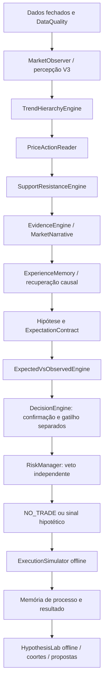

# Market Intelligence Layer V3

O [prompt mestre consolidado](PROMPT_MESTRE_V3.md) reúne o original, a fundação V2 e a atualização V3. O [bloco de integração V3](PROMPT_MESTRE_ADENDO_V3.md) também está disponível separadamente para reutilização. O processo mental tem vinte passos, de OBSERVE a PROMOTE, e pode terminar legitimamente em WAIT, MONITOR ou NO_TRADE.

## Responsabilidades



`TrendHierarchyEngine`, `PriceActionReader`, `SupportResistanceEngine`, `EvidenceEngine` e `MarketNarrative` não importam adaptadores de corretora, simulador de execução ou autorização de risco. Seus resultados são observações estruturadas. O `DecisionEngine` aplica a política da estratégia antes de chamar o risco; o risco continua com veto próprio. O código existente de estrutura/swings é preservado em `structure.py`, evitando uma migração de caminhos sem necessidade.

## Tendência por timeframe

Cada estratégia declara papéis macro, contexto, estrutura e execução. Não há uma combinação universal obrigatória. Os padrões iniciais são múltiplos relativos do timeframe de execução (12, 6, 3 e 1); podem ser alterados no CLI:

```powershell
.venv/Scripts/python.exe run_replay.py --csv HISTORICO.csv --timeframe M5 --macro-timeframe H4 --context-timeframe H1 --structure-timeframe M15 --validate-temporal
```

Os períodos aceitam `M<n>`, `H<n>` ou `D<n>`, precisam descer em múltiplos inteiros da execução e são ancorados em UTC. Semanas, meses e dias de corretora exigem outro calendário; não são aproximados como períodos fixos. A captura MT5 ainda depende dos períodos aceitos pelo terminal. Papéis iguais são aliases explícitos do mesmo dado: não criam novas confirmações nem evidências independentes.

Somente buckets completos e contíguos são agregados. Candles HTF em formação e buckets com componentes ausentes são descartados. Volume agregado continua sendo específico do provedor. O tempo de confirmação de um swing é o fechamento da barra à direita que o tornou confirmável, não a abertura dessa barra.

Cada timeframe tem estados UNKNOWN, POTENTIAL_BULL/BEAR, BULL/BEAR_CONFIRMED, BULL/BEAR_WEAKENING, TRANSITION e RANGE. A progressão usa topos/fundos confirmados; são exigidas ao menos duas atualizações distintas de candles fechados para confirmar uma direção. Repetir o mesmo candle não avança contadores. Romper o fundo protegido de uma alta produz transição/reversão parcial e não uma baixa confirmada. Os pivôs antigos não podem reafirmar alta enquanto a quebra permanecer.

O parentesco registra ALIGNED, CORRECTING_PARENT, COUNTER_TREND, TRANSITIONING, RANGE_INSIDE_TREND, CONFLICTING ou INSUFFICIENT_DATA. Uma direção menor oposta dentro do swing protegido do pai é descrita como correção; a saída não muda automaticamente o rótulo de todo o ativo. Esse critério é uma aproximação de engenharia que precisa de avaliação histórica.

## Price action e zonas

`PriceActionReader` mede range, corpo, pavios, posição do fechamento, deslocamento, sobreposição, expansão/contração e progressão relativa. Distingue retorno à faixa rompida, ausência de continuidade e continuidade observada. Desaceleração não vira previsão de reversão. Os limiares iniciais de expansão/contração (1,5 e 0,67 vezes o range mediano anterior) são parâmetros de pesquisa, não regras extraídas dos livros.

`SupportResistanceEngine` usa swings confirmados para construir zonas, preservando timeframe, origem, instante de disponibilidade, testes, mudança de função, rompimento e reteste. Zonas equivalentes no mesmo timeframe são agrupadas; toques não recebem peso probabilístico. A largura usa o parâmetro de tolerância e a expiração é configurável, inicialmente 300 barras do timeframe de origem. O snapshot guarda as doze zonas mais próximas e preserva também a resistência acima e o suporte abaixo mais próximos para não perder um obstáculo relevante ao alvo. Não há score de “força” derivado da quantidade de testes.

## Evidência, confirmação e gatilho

Cada `Evidence` tem origem, regra descritiva, direção, timestamp, expiração, referência aos dados, categoria e grupo de dependência. `EvidenceSet` preserva fatos altistas, baixistas, neutros, contrários, ausentes e invalidantes.

Tendência e níveis derivados dos mesmos swings pertencem ao grupo `structure`. Sequência de barras e momentum derivado dela pertencem a `bar_sequence`. Recontar HH/HL por outro nome ou em papéis aliases não adiciona um grupo. Isso reduz duplicação de features; não demonstra independência estatística entre transformações de OHLC, inclusive entre timeframes agregados do mesmo feed.

O peso inicial é categórico: INSUFFICIENT, CONFLICTED, WEAK, DEVELOPING, SUPPORTIVE, STRONG_BUT_UNCONFIRMED, CONFIRMED ou INVALIDATED. A classificação usa validade, conflitos, completude e diversidade de famílias de features; não atribui pesos numéricos ou probabilidades. Poucas famílias coerentes significam leitura de contexto, sem autorização operacional. Volume tick não é incluído como evidência direcional independente sem uma política de volume validada.

O `ExpectationContract` distingue eventos de confirmação, evento de gatilho e contexto esperado. A comparação guarda contexto esperado versus observado: tendência, estrutura, price action, reação ao nível, momentum e continuidade podem ser definidos no contrato. A estratégia inicial exige direção do contexto e retorno à região; o gatilho continua sendo um fechamento posterior além do extremo do candle de retorno. Mais dimensões podem ser declaradas por uma estratégia, sem presumir que são universalmente favoráveis.

Confirmação sem gatilho gera WAITING_FOR_TRIGGER. Invalidantes ativos ou evidência expirada impedem autorização. Conflitos contextualizam enfraquecimento/contradição sem apagar o contrato anterior. O RiskManager é chamado somente depois dos gates técnicos e do gatilho; ele pode vetar mesmo assim.

## Política da estratégia atual

`research_breakout_retest`, versão `2.0-v3`, declara WITH_TREND e exige contexto/estrutura confirmados. Transições resultam em espera. Macro ausente fica explícito como advertência, não é fabricado; contexto/estrutura ausentes impedem entrada. Não se exige alinhamento perfeito universal: o motor descreve correções e conflitos e cada estratégia declara suas classes aceitas. Uma estratégia contratrend ou de reversão precisará de critérios, evidências, experimento e aprovação próprios; não foi criada automaticamente nesta etapa.

A política atual também verifica obstáculos estruturais ao alvo. Essas mudanças alteram o conjunto de sinais da estratégia; resultados das versões anteriores não validam a V3. Falta de dados HTF, evidência fraca/conflitante ou ausência de gatilho pode resultar em uma janela inteira sem trades. Não se reduz o critério para fabricar amostra.

## Memória, monitor e pesquisa

O SQLite migra dos schemas 1/2 para 3 de forma aditiva. `market_intelligence` registra o EvidenceSet com hash e vínculo ao snapshot; os snapshots completos permanecem no journal original. Experiências incluem estado/alinhamento, classe direcional, price action, zonas, IDs de evidência, fatos ausentes/contrários, confirmação, gatilho, reversão parcial e continuidade observada. O resultado posterior herda o contexto congelado na decisão, sem reescrever o passado.

A recuperação pode filtrar por classe direcional e estado de evidência, além do corte temporal e versão da estratégia. `HypothesisLab` gera coortes descritivas e perguntas sobre alinhamento, redundância, confirmação, continuidade e distância de zonas. Média em R fica ausente abaixo do piso amostral. Não há promoção automática, probabilidade calibrada ou ajuste no holdout.

O monitor Dukascopy usa a percepção V3 sobre candles fechados, mas permanece OBSERVATION_ONLY: um candidato antigo não vira BUY/SELL autorizado sem hipótese, expectativa, gatilho e risco no agente. O percentual antigo de “confiança”, derivado de contagem de filtros, foi removido. A avaliação Jev é rotulada como parecer experimental. O analisador/backtest legado continua identificado como pesquisa de indicadores, separado do fluxo operacional V3. O gráfico MT5 pode exibir o candle em formação visualmente; ele não é usado para confirmar a inteligência V3.

Relatórios de replay agora incluem estados V3 por decisão, contagens por categoria, `research_cohorts.json` e `intelligence.jsonl.gz` com os snapshots completos para auditoria. Os arquivos de mercado gerados continuam fora do Git. A avaliação 60/20/20 preserva a janela final por padrão e usa contas/memórias independentes por partição.

## Leituras e limites

Veja [referencias_v3.md](referencias_v3.md) para capítulos/páginas conferidos, aprendizados e adaptações. O catálogo tem 17 conceitos, todos ainda em revisão; parâmetros computacionais são decisões de engenharia. O estágio não executa ordens reais: `ALLOW_ORDER_EXECUTION=false`, `ALLOW_LIVE_TRADING=false`.
